# Wits in a browser

The server, the interface it serves, the desktop window and the phone.
[The README](../README.md) gets it installed; the command line and the terminal
interface are in [Wits in the terminal](./terminal.md). The interface carries
its own **User guide**, on the header's menu (⋮): every page with pictures, and
the command beside each that does the same in a terminal.

- [Starting it](#starting-it) · [The desktop window](#the-desktop-window)
- [The dashboard](#the-dashboard) · [One jar in full](#one-jar-in-full) · [I forgot to](#i-forgot-to)
- [Recording a fill](#recording-a-fill) · [Pricing the fills](#pricing-the-fills)
- [The jars, the journal and the replay](#the-jars-the-journal-and-the-replay)
- [Effects, and the map of the strains](#effects-and-the-map-of-the-strains) · [Devices](#devices)
- [The year, on one card](#the-year-on-one-card) · [Packing for a trip](#packing-for-a-trip)
- [A demo, to look around](#a-demo-to-look-around) · [Which repository](#which-repository)
- [Keys, themes and small screens](#keys-themes-and-small-screens) · [What it talks to](#what-it-talks-to)
- [On the phone](#on-the-phone)

## Starting it

`wits-server` serves the repository it is started in, and the interface built
from `wits-ui/` beside it:

```sh
make serve          # builds both, then serves the repository here
open http://127.0.0.1:7341
```

It reads and writes through the same recorder as the commands, with the same
refusals in the same words, and follows the repository: an entry made with the
command line shows within a few seconds. There are four tabs — **Dashboard**,
**I forgot to**, **Shelf** (Jars, the Journal, Devices) and **Insights**
(Analysis, Effects, History, Costs) — and **Record**, always in reach, to
grind, record a session, a fill or a weighing.

## The desktop window

The window is [Electron](https://www.electronjs.org/), so the AppImage
carries a Chromium of its own: that is most of its size. A system web view
(Wails, Tauri) would have kept it near 25 MB, but needs WebKitGTK on the
machine, and a Steam Deck has none; Electron runs the same everywhere. It
carries NSS and ALSA too, which SteamOS lacks. Chromium sandboxes its pages
where the kernel lets it (on Ubuntu 24.04 and later AppArmor does not, and it
runs without), and the window shows only this server's own pages.

## The dashboard

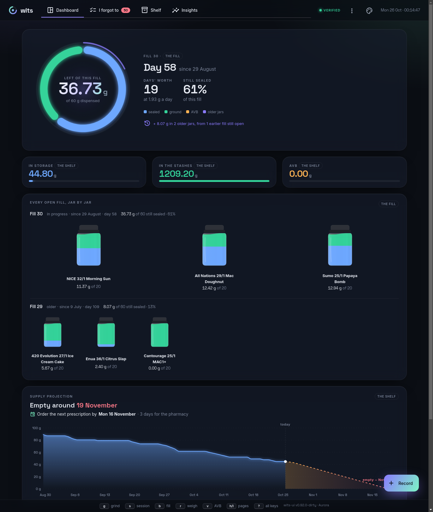

What is happening now. The fill in progress is a ring — sealed, ground, AVB —
with the older jars around it as a halo. Under it stands **every fill not yet
emptied**, jar by jar: fill 30 above, and fill 29 below it still holding
8.07 g of its own, each jar of glass filled to what that fill holds of it.
Then the shelf's supply as a curve to the day it runs out, with the day to
order the next prescription by, and the last twenty weeks of grinding and
sessions as calendars.

## One jar in full

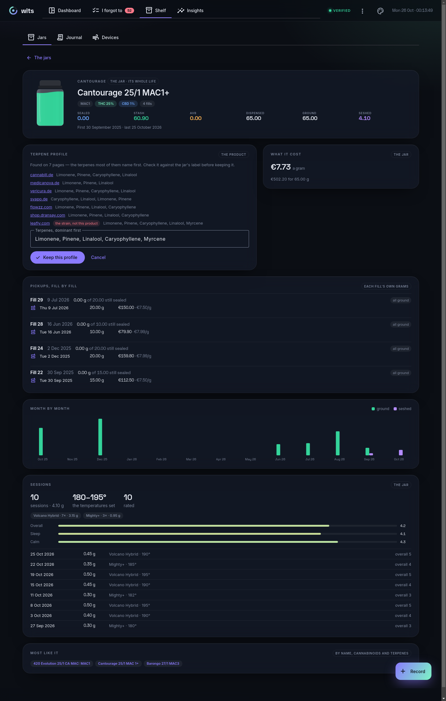

A jar, on the dashboard or on the Shelf, opens in full:

- what the product is — producer, strain, THC and CBD — and its **terpene
  profile**;
- **every fill of it**, what that fill dispensed and still holds sealed, and
  each pickup with what it cost and where;
- what it cost a gram, over every priced pickup;
- what was ground and seshed of it **month by month**;
- its **sessions**: how many, on which devices, the temperatures set, each
  rating's mean and the latest eight;
- the products most like it.

The jar's own figures are its whole life; each fill's are that fill's. (The
picture is the workbook's MAC1+ with ten sessions, their ratings and four
prices added, since the workbook has none of them.)

No terpenes written down? **Research terpene profile** looks them up. It
searches the web for the product as the pharmacy sells it — Brave Search, or
DuckDuckGo when Brave turns the request away — and asks Leafly for its
strain, reads which terpenes each page names, in German or English, and
offers a profile: the terpenes most pages name first, five at most, with the
pages it came from. Leafly's is marked as the strain's, not this product's.
Nothing is written down until you keep it, as found or as you correct it
against the label; **Edit** types one in. On the workbook's MAC1+ it found
seven pages, and the first eight jars on the list each came back with a
profile, from three to eight pages each.

## I forgot to

Everything left undone that the ledger can show, each section there only
while there is some, and the tab counts them:

- sessions of the last week waiting for a rating;
- strains used in the last 90 days not yet rated as a whole;
- pickups still to be priced;
- stashes left behind, where a jar has nothing sealed left but its stash
  still holds grams, all ticked and cleared together;
- AVB waiting in a device, with **Collect**.

On the workbook it counts 50: two pickups and 48 stashes left behind,
1,154.00 g. Two more are offered but not counted: the jars still sealed, with
**Weigh**, since a weighing that agrees with the ledger writes nothing; and
the jars with no terpene profile, since one no page names would never clear.
**Research all** looks those up one after another, a pause between, and
**Keep all found** writes down every profile it found at once.

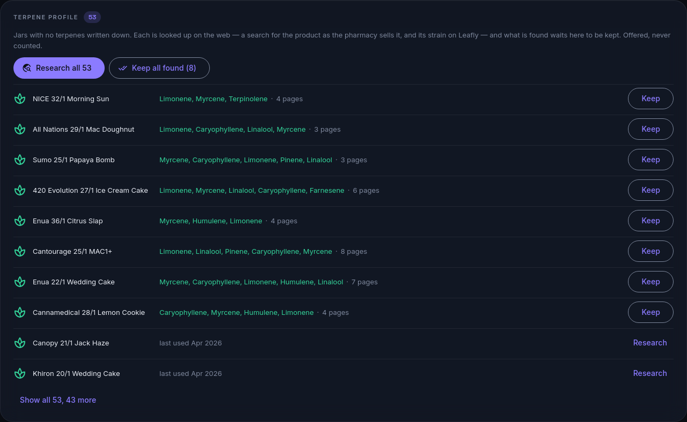

## Recording a fill

A fill holds one strain or several, each with its grams and its price a gram,
and records as one: all of them or none, each with its price written down.
**Add 19% VAT (Germany)**, on unless switched off, adds the tax to the prices
typed in.

**Read the label** takes a photograph of the pharmacy label and fills in the
product and the grams, matched to a jar you already have when it is one. The
text is read in the browser, by Tesseract compiled to WebAssembly and served
by wits itself, so the photograph goes nowhere — check what it read, then
record.

**Read invoices** takes one or more of the pharmacy's PDF invoices and fills in
their strains, matched to your jars, with the invoice's own totals — which
already include VAT, so none is added to them — and the fill dated the day
ordered. The PDF is read in the browser by pdf.js, and only its text is sent,
so the invoice, which names you, goes nowhere either. An invoice for a fill
already recorded is not recorded again: on the same day, the form says so and
offers to price that fill from it. Within two weeks, it asks whether it is
that fill. Only an invoice that matches no fill adds its strains as a new one.

## Pricing the fills

**I forgot to** walks it a fill at a time, as the prescription was picked
up, newest first and every purchase without a price unless switched to only
those in storage: on the workbook, 88 purchases in 30 fills, three strains to
most of them.
Type each strain's price a gram, and **Add 19% VAT (Germany)**, on unless
switched off, puts the tax on top; the fill's total is worked out as the server
writes it. Or **Scan invoice**: the pharmacy's PDF is read in the browser and
its prices fill the strains, the invoice's first page shown beside them to
check against. If the invoice is dated a few days off the pickup (ordered one
day, picked up the next), it asks first. If it belongs to another fill, it says
which one and offers to go there.

**Add invoices** takes many PDFs at once, and **Pick a folder** takes every PDF
in a folder. Each is read in the browser and listed newest first, with the fill
it is for and how many days apart they are. The ones that matched a fill not
yet priced are ticked, and **Price N fills** prices them all at the invoices'
totals. The eye opens one on its pickup's card, its first page beside it. All
37 invoices kept from three pharmacies read in 3.3 seconds. 32 were ticked
for all 30 fills, and five matched no fill: four from before the workbook
begins, and the September one. A pickup with no
price to be had, no invoice kept, is ticked **No price to be had — stop
asking**. It is written down and asked about no more, still counted as without
a price, and a price given later supersedes it.

Invoices from three pharmacies are read. One prints a product on one row.
One ships, spreads a product over three rows under its PZN, and dates the
invoice day first with slashes. One names a product on a row and prices it on
the dosage row below, with delivery and the narcotics fee in the same shape. What an invoice charges besides flower by the
gram, such as a vape cartridge by the piece or shipping, is left out of the
fill and named, so the invoice still adds up to its total. An invoice's line is
matched to the fill's own products, not only by name. A strain the invoice
names under its breeder, or cuts short, still finds its jar: "Cookies 22/1
Hawaiian Rain" is the workbook's "Cansativa 22/1 Hawaiian Rain". A strength
printed differently, such as 14/1 against 16/1, is another product. Checked
against all 37 invoices kept from the three pharmacies, on a fresh import of
the workbook. The 32 for fills in it priced every one of the 30 fills,
10,156.01 € for 1,244 g, the same to the cent as their lines added up apart.
Nothing new was recorded. The five for pickups the workbook does not hold
matched no fill. The one purchase left without a price is a 10 g jar its
fill's invoice does not list.

**Insights → Costs** shows what the prices add up to:

- **The headline:** what was paid, a gram over everything, a gram lately (the
  last 90 days), and a month at the current fill's rate.
- **Every purchase over time,** as a dot for its price a gram, with a line
  through each fill's.
- **Each strain,** in a table you sort by any column, with a line of how its
  price moved. A strain gathers the same cultivar under every name and
  producer it came by: MAC1 from 420 Evolution and Cantourage, Hindu Kush
  from IMC and Canopy. Open one for every purchase of it, priced over time.
- **Each pharmacy,** named from its invoices.
- **Strength against price.**
- **By year, fill and month.** A fill opens to its purchases.

On a chart, a pharmacy is told by its shape as well as its colour. Priced from
all 37 invoices, the workbook's purchases come to 10,156.01 € for 1,244 g. A
gram cost 10.73 € in 2023, 9.75 € in 2024, 6.96 € in 2025 and 6.25 € in 2026:
10.38 € at one pharmacy, 6.74 € and 6.52 € at the other two. Strength bought
no premium: under 20 % THC was 6.13 € a gram, 20–24 % 8.79 €, and 30 % and up
8.08 €. Shipping and the narcotics fee are not in these.

## The jars, the journal and the replay

A strain can be rated as a whole, apart from any one session: overall, its
taste and its aroma, 1 to 5 each or left out, whether you would have it again,
and a line about it. **Rate** on its card on the Shelf, its own page, or
**I forgot to**, which asks after every strain used in the last 90 days that
has no rating; on the command line, `wits describe enua-wedding --rating
"overall=4 taste=5" --again yes --say "lemon, then pepper"`. Rated again, the
newer rating stands. It is kept with the product, travels in bundles and
syncs: of two devices' ratings of one strain, the one given last stays.

The jars are a gallery, every product a card across its life; tick the cards
— or **Select all** — and **Clear stash** records their stashes as consumed,
one adjustment each in a single write: the terminal's history clean-up, for
the stashes you choose. The journal scrolls all of its entries and undoes one
with a correction.

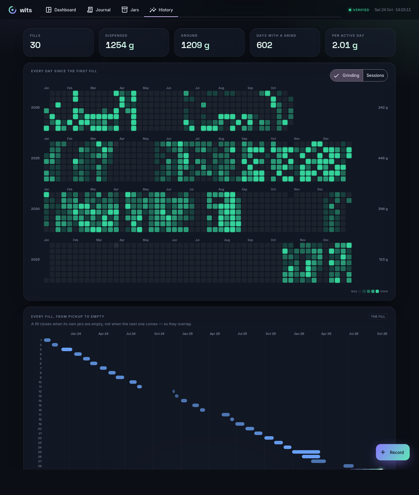

The history is three years of grinding as a calendar, and every fill as a
lane on one timeline, overlapping the way fills do. **Analysis** is the
terminal's long view — this fill, the last 30 or 90 days, 12 months, all
time — and the record played back through it. Press play and everything
replays from empty, an entry a moment: the daily chart fills in, the products
race each other up the ranking, the fills grow on their timeline. Above them
the record is laid out in time — the grams ground week by week, a blue tick
at every pickup, the years or the months marked — lit up to the playhead;
point anywhere on it to go there, or step with `←`/`→`. Under it runs the
tape: the newest entries in a row, each new one coming in at the right and
pushing the others along, at the replay's pace. The panel keeps one height,
playing or live, so nothing under it moves. The jars replay the same way,
filling as fills arrive and draining as they are ground. `?at=2025-02-14`
opens either as the record stood that day.

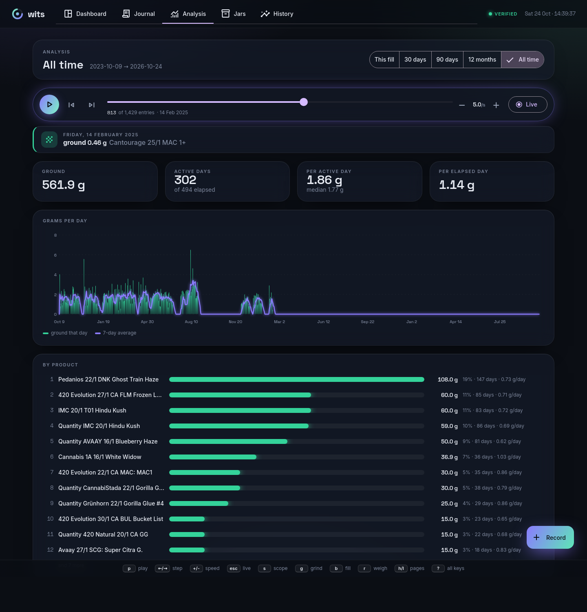

The analysis tab also draws **tolerance**: grams a day against how the sessions
went, both over the same 14 days rolling. Tolerance creeps when the grams climb
and the rating stays flat. Breaks, a week or more with nothing ground and no
session, are shaded behind the curve, and the replay draws it day by day, so you
can see whether it comes back down after one. A week, not three days: the
workbook grinds every two or three days, and at three days its last 90 held
eleven "breaks" that were only the habit. At a week it holds one, 12 to 18
September, and ten over the whole record, the longest 99 days.

**Film** on the Jars page records the replay as a video: three years of the
shelf in thirty seconds, from the same replay the page plays, each jar sealed
blue under ground green, paced evenly through time rather than entry by entry.
It is WebM, MP4 on Safari, recorded by the browser itself, and a phone hands it
over to share.

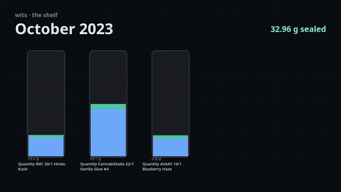

## Effects, and the map of the strains

**Effects** is the effect log. Each session waits to be rated, under **I
forgot to** — 1 to 5, tapped, on how it went overall and on pain, sleep,
calm, mood, focus or appetite, any of them — and what the ratings add up to is
drawn three ways: every product against every dimension, each dimension by
temperature band, and by time of day as a wheel. Every mean says how many
ratings it stands on, and one that stands on a single rating is hatched: a
rating, not a finding. `wits rate last sleep=5` does the same from the command
line, and `e` on the terminal interface's sessions screen.

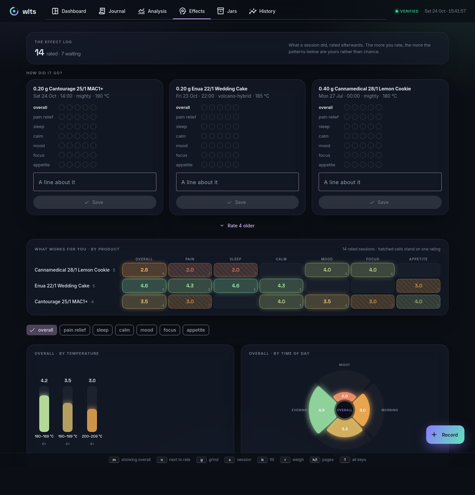

Under it is **a map of the strains**, laid out by terpene profile: strains that
share their terpenes sit together, whatever they are called or however strong.
Each is marked by what it tastes of most — citrus, fruity & floral, herbal &
pine, earthy, spicy, each a colour and a shape — or coloured by how its
sessions went, and sized by what was dispensed. Pick one and it shows its taste
as a wheel, its terpenes, and the five strains most like it: how alike, and
which terpenes they share. Point at one of those and its taste is drawn over
the picked one's.

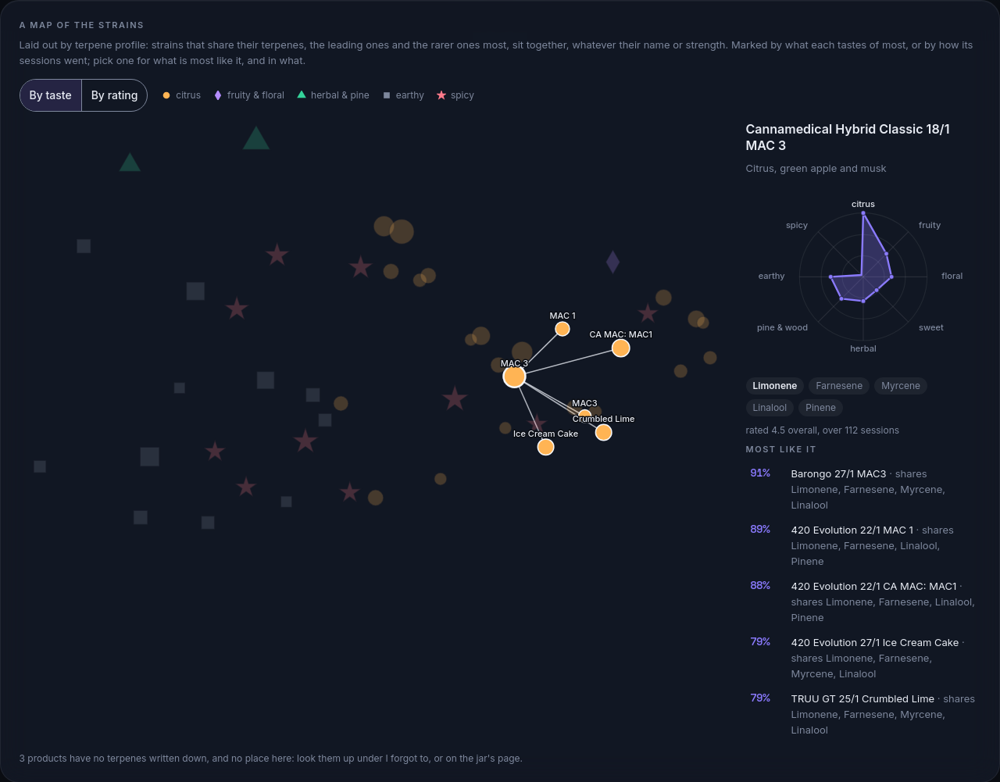

Alike is mostly the profile. The dominant terpenes count most, and the rare
ones more than those nearly every jar has: Limonene is in 45 of the demo's 50
profiles, Terpinolene in 9, so sharing Terpinolene says more. Two profiles
that taste alike — citrus-led, say — count as nearer even through different
terpenes. The cultivar's name counts a little, THC and CBD hardly: between 20
and 30 % they say almost nothing of what a strain is like. A product with no
terpenes written down is compared by name alone and ranks below any known
profile. `wits like` says the same on the command line:

```console
$ wits like cantourage-mac1-251
Like Cantourage 25/1 MAC1+ (citrus, flowers and pine):
   99 %  Cantourage 25/1 MAC 1+ — shares Limonene, Linalool, Pinene, Caryophyllene, Myrcene
   98 %  420 Evolution 25/1 CA MAC: MAC1 — shares Limonene, Linalool, Pinene, Caryophyllene, Myrcene
   87 %  enua 22/1 Black Cherry Punch — shares Limonene, Linalool, Pinene, Caryophyllene, Myrcene — rated 4.1 overall, over 39 sessions
   86 %  420 Evolution 22/1 CA MAC: MAC1 — shares Limonene, Linalool, Pinene, Caryophyllene
   86 %  420 Evolution 22/1 MAC 1 — shares Limonene, Linalool, Pinene, Caryophyllene
```

Under the map, **the terpenes on the shelf**: every terpene your products
name, what it tastes of, how many name it and lead with it, and how their
sessions went — each product counted by its rated sessions and by where the
terpene stands in it, a trace less than the lead. A jar's own page shows the
same: its taste in words and as a wheel, each terpene with what it tastes of,
and what it is most like.

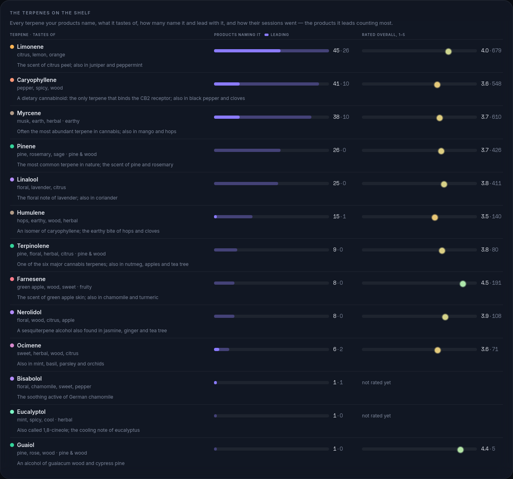

The workbook names its cultivars but lists no terpenes, so until profiles are
written down the map has nothing to place. Look them up from **I forgot to**,
or write one down as the label gives it — `wits describe enua-wedding --terpenes
"Myrcen, Limonen, Caryophyllen"` or the terminal's product form.

## Devices

**Devices** lists every device by what it is for:

- **Vaporizers and glass,** what a session is had with.
- **Induction heaters and torches,** what heats a manual one.
- **Grinders.**

**Add a device** starts from a preset, or from nothing. The presets cover the
Storz & Bickel Venty and Mighty+, the Limelight Herb Frolic, the Vestratto
Tornado and Anvil, the Mad Heaters Tempest, the Simrell and the Simrell
Hydro, the YLL 3.0, the Blazer PT-4000 and PB-207, the Brilliant Cut and
Aroma 3 grinders, and dry and water glass. A preset fills in what could be
found out about the device; what couldn't stays empty for you to fill.

A device has:

- what it is: manufacturer, model and the maker's country;
- electric or manual;
- its way of heating: convection, conduction or hybrid;
- how it's used: on demand, session or both. A manual vaporizer is on demand,
  heated once, inhaled, and its AVB tossed.
- its temperature range, and how long it stays on unused before it turns
  itself off;
- its modes. Each mode can heat its own way, be run at its own usual
  temperature, and run a session timer: the Frolic's On demand is convection
  at 165 °C, its Session hybrid at 185 °C for 420 s.
- what it cost, where and when it was bought, a link and notes.

A card also shows what the device has done: its sessions and grams, the
sessions it heated, when it was last used, and its price per session so far.
A device can be retired; it's kept, since its sessions name it. Recording a
session asks for the device's mode, when it has modes, and starts from that
mode's temperature and timer. A manual vaporizer or glass also asks what
heated it, and at which of the heater's settings: an induction heater's
wattage. The Journal shows it all, as in "Vestratto Tornado · heated with YLL
3.0 at 45 W".

## The year, on one card

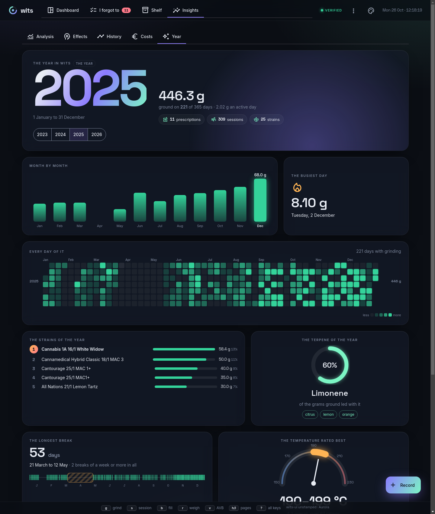

**Insights → Year** is the year in wits, `wits review` with more room: the
year in big numerals with what was ground and on how many days, then a card
for each finding. The months as bars, the busiest lit; every day of the year
as a calendar; the strains of the year ranked, the first crowned; the terpene
most of the grams led with, as a ring and its flavours; the longest break
opened out on the year's line; the temperature rated best on a vaporizer's
dial; the strain rated best in stars; the device of the year; and what it
cost, every priced purchase on one line from the cheapest gram to the
dearest. The cards rise in turn. A year still running says "and counting",
and the months to come stand as outlines. On the demo, 2025 is 446.3 g on
221 of 365 days, a 53-day break in spring, 190–199 °C rated best at 4.2 over
67 ratings, and a gram from €3.99 to €10.99. `?year=2025` opens a year.

## Packing for a trip

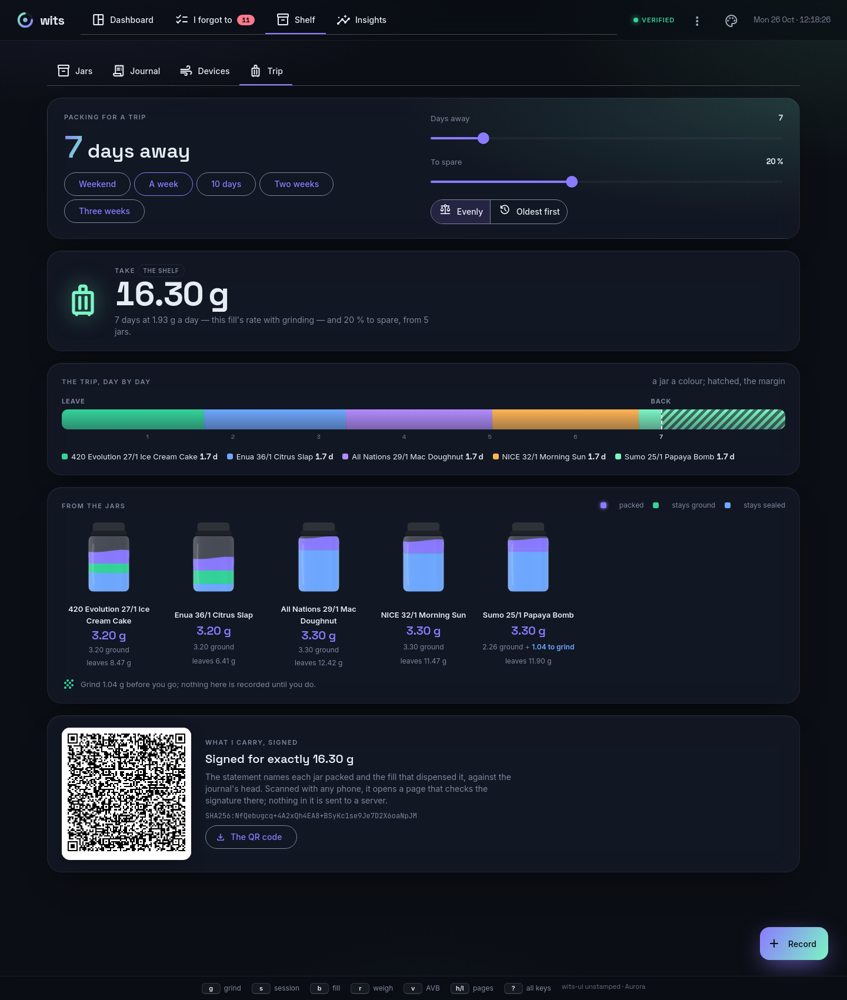

**Shelf → Trip** is `wits pack`. Pick the days away — a weekend, a week,
two, or anything to six weeks on the slider — how much to take on top, and
whether to draw **evenly**, every jar giving about the same so they go down
together, or **oldest first**. It says what to take, lays the trip out day by
day with a jar a colour and the margin hatched past the day you are back,
shows each jar with the grams it gives lit in it (ground first, then sealed,
which wants grinding before you go), and signs a QR code for exactly what is
packed. Nothing is recorded.

## A demo, to look around

**Seed with demo data**, on the header's menu (⋮), opens a repository made to
show every page with something on it, without touching yours. It is the
workbook with the pharmacy invoices' prices, every device preset, a year of
sessions — 897 of them, 718 rated, on the Venty, the Mighty+ and the Frolic,
with the AVB weighed out of each every dozen or so — every jar's terpenes
looked up, and the stashes left behind cleared. It is restored into
`wits-demo` in your home folder (`/wits-demo` on the phone) and served; asked
for again, that repository opens as you left it. **Repository** goes back to
yours. The sessions and ratings are made up, from a seeded generator; the
rest is the workbook's and the invoices'. `make demo-seed` makes it again
(`assets/demo-seed.wits`, a few minutes and the live web).

## Which repository

The **Repository** page, off the header's menu (⋮), is where the server is
pointed. Browse this computer's folders to open another repository, those
that are one marked *wits*, or make one in an empty folder or a new one; the
server serves it from then on, and every page reads it. There, too, a
tracking workbook can be **imported** from the browser: it is read and
reported first, as `wits import` reports it, and written only when you
import, into an empty journal only. The phone has the page too, on its own
storage: see below.

## Keys, themes and small screens

Every key the terminal has is here too, and the footer shows the ones the page
answers: `g` `s` `b` `r` `v` to record, `1` to `4` for the tabs and `h`/`l`
through every page in turn, `p` to replay, `j`/`k` to move, `space` to tick,
`o` to open a jar, and `?` for all of them. The old addresses (`/jars`,
`/costs` and so on) still lead to their pages. `?record=grind` (or `session`,
`fill`, `weigh`) opens the form on that tab — a link to bookmark.

The palette in the header picks one of 41 themes, and `t` steps through them
(`T` back): wits' own Aurora, then Nord, Dracula, Gruvbox, Solarized, Tokyo
Night, Mocha, Rosé Pine, Phosphor, Synthwave, Void, Forest, Ember, Abyss,
Bauhaus Dark, Blueprint, Deco, Hazard, Amber, Noir, Starfield, Topo and
Contrast in the dark, and Paper, Solarized Light, Latte, Sakura, Bauhaus,
Daylight, Dune, Drafting, Greenbar, Risograph, Swiss, Chicago, Sumi, Kraft, Dot
Matrix, E-Ink, Glacier and Memphis in the light. Some draw their paper:
Blueprint a cyanotype grid in three line weights, Greenbar tractor-feed bands,
Deco a gold sunburst, Noir light through the blinds, Topo contour lines. They
differ in more than colour — Paper is cream and serif with square corners,
Phosphor a green CRT in monospace with scanlines, Bauhaus hard black edges and
offset shadows on a grid, Mocha and Latte rounded and pastel. Each keeps the
account colours' meaning — storage blue, stash green, AVB amber — in its own
shades. The choice is this browser's, kept in its local storage;
`?theme=paper` opens the page in one without keeping it. The theme's name is
beside the build at the end of the help line.

On a phone the tabs give way to a dock under the thumb: Dashboard, Forgot, a
raised **Record**, Shelf and Insights, with the count on Forgot. The header's
menu holds the User guide, Repository (and Sync), and the build and theme at its foot. The top
bar names the page you are on, and the bars keep clear of the notch and the home
indicator. It is laid out for an iPhone 11 Pro held upright (375 px) and
nothing narrower; no page scrolls sideways. There, Analysis's scopes go by
short names (Fill, 30 d, 90 d, 12 mo, All), the jars are a compact list, and
the dashboard's jars stand three to a row.

## What it talks to

It answers this machine only. The server listens on a loopback address and
refuses one that is not; a request naming any other host is refused, which keeps
a web page elsewhere from reaching it; and every write must be JSON, which a page
on another origin cannot send. Every font and icon ships with the interface, so
the page itself makes no network call. The one thing that reaches out is a
terpene lookup, and only when asked: the server, not the page, asks the search
and Leafly, sending the names of the product and its strain and nothing else.

## On the phone

The same interface runs on a phone, with wits itself inside it: the
repository, the recorder and the API that `wits-server` runs, compiled to
WebAssembly. The phone keeps its own copy of the journal in the browser and
refuses the same things in the same words as the terminal. It works offline
once it has loaded, and a home-screen shortcut opens the grind form directly.
Everything above is there, terpene lookups included. A page in a browser may
read another site only when that site allows it, and neither search does, nor
Leafly, so the phone asks through [Jina's Reader](https://jina.ai/reader/),
which fetches a page and lets any page read it: the reader sees the names of
the product and its strain, and nothing else. It takes twenty requests a
minute, so **Research all** on the phone takes a jar every nine seconds and,
when told it asked too fast, waits half a minute and asks once more. Brave's
results do not come through the reader, so the phone searches DuckDuckGo.

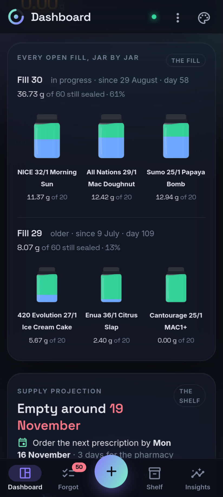

It's served from GitHub Pages at <https://thedondope.github.io/wits/>, and
holds no data there. Install it from the browser's menu (**Add to home
screen**). The phone syncs through the same folder as `wits push` and
`wits pull`, by hand:

1. On the device that made the folder, show the key: `cat .wits/remote.key`.
2. On the phone, open **Sync**, open `wits.age` from the shared folder (on
   Android, the folder Syncthing keeps), and paste the key the first time.
3. **Sync** pulls the folder's entries in, chains the phone's own on top, and
   pushes. **Save wits.age** then hands the result to the Files or Syncthing
   app to save over the one in the folder.

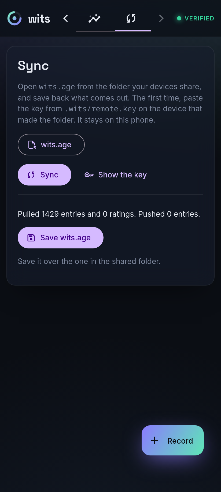

A browser on a phone can read a file you pick, but it can't write into a
folder by itself. That's why the result is shared or downloaded, and why you
save it over the folder's copy yourself. The key and the journal never leave
the phone except inside that encrypted file. `make pages` builds what Pages
serves, and `make wasm-check` syncs the engine with the command line both ways.

The phone has **Repository** too, beside **Sync** on the header's menu, on its own storage
in the browser: the first repository is `/wits`, others can be made in new
folders beside it and opened in turn, and a tracking workbook can be imported
into an empty one, with no computer involved. The phone reopens whichever was
open last, and Sync syncs that one, each repository with its own key. The
build a page is, `git describe` when it was made (`wits-ui v0.82.0`, or
`v0.82.0-3-gabc1234` between releases), is at the end of the help line and at
the foot of the header's menu on a phone, with the theme's name beside it. The phone's page is cached for offline use,
so if it names an older build than the latest release, close and reopen it to
take the new one.
