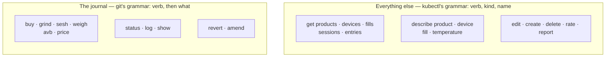
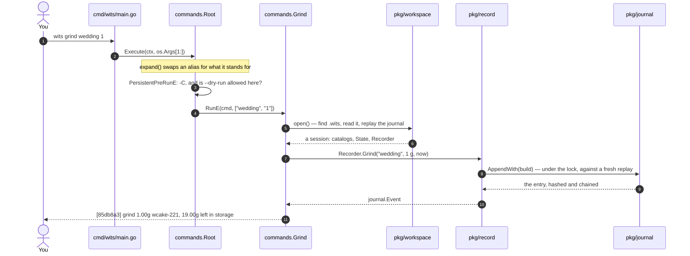
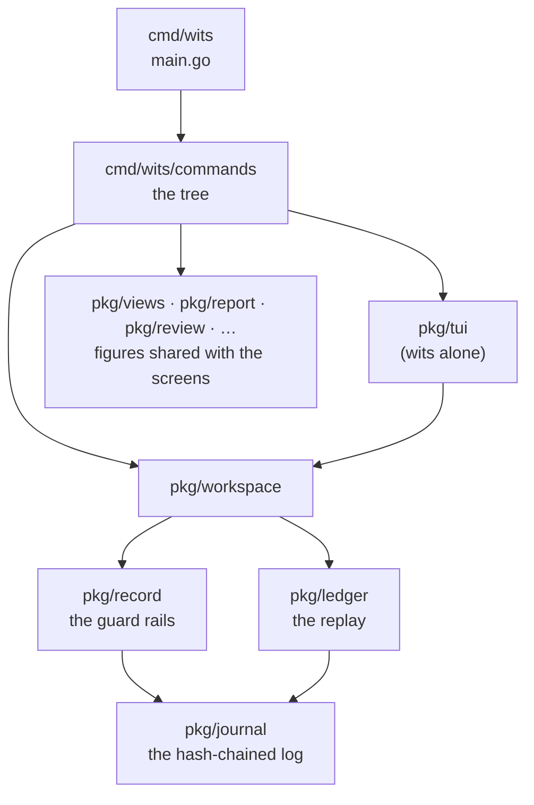

# Cookbook: the command line

<!-- The collapsible sections below are HTML (<details>), which GitHub folds
and unfolds; markdownlint's no-inline-html rule is off for this page alone,
so they can be. -->
<!-- markdownlint-disable MD033 -->

This chapter explains how `wits` works as a command line: how a few lines in
`main.go` become `wits grind wedding 1`, which parts of Go carry it, what
Cobra does, and why the commands are named as they are. It ends with recipes
for adding commands of your own.

## Contents

1. [A first look](#1-a-first-look)
2. [The two grammars](#2-the-two-grammars)
3. [How a command travels](#3-how-a-command-travels)
4. [Cobra in five minutes](#4-cobra-in-five-minutes)
5. [The Go that carries it](#5-the-go-that-carries-it)
6. [Recipes](#6-recipes)
7. [Before you open a pull request](#7-before-you-open-a-pull-request)

---

## 1. A first look

Build it and make a repository to try things in. A repository is a folder
with a `.wits` directory in it, the way a git repository has `.git`.

```console
$ make build && export PATH=$PWD/bin:$PATH
$ wits init /tmp/try && cd /tmp/try
Initialised empty Wits repository in /tmp/try/.wits
$ wits buy "Enua 22/1 Wedding Cake" 20g
New product Enua 22/1 Wedding Cake — refer to it as wcake-221
[9eaab97] purchase 20.00g wcake-221 into storage
$ wits grind wedding 1
[85db8a3] grind 1.00g wcake-221, 19.00g left in storage
$ wits get products
SLUG       NAME                    STORAGE  STASH
wcake-221  Enua 22/1 Wedding Cake  19.00 g  1.00 g
```

`wedding` was enough to name the product: any unambiguous part of a name,
or its slug, will do. Your hashes will differ, since each one covers the
moment it was written.

`wits --help` lists every command, grouped by what it does. Every command
also takes `--help`, with examples.

> [!NOTE]
> The rest of the output in this chapter comes from the demo repository, a
> year of made-up records in `assets/demo-seed.wits`. Clone it to follow
> along: `wits clone assets/demo-seed.wits /tmp/demo && cd /tmp/demo`.

---

## 2. The two grammars

Wits gives you two kinds of thing to do, so its command line has two
grammars.

**Writing the journal reads like git.** The journal is an append-only,
hash-chained log, the way a git history is. Something happens (a fill
arrives, a jar is ground, a session is had), and you record it with a short
verb, the way you `git commit`. You read the record back with `log` and
`show`, and put it right with `revert` and `amend`, never by editing it.
Entries are named by hash, or counted back from the newest as `HEAD`,
`HEAD~1`, `HEAD~2`, as git counts commits.

**Everything else reads like kubectl.** Products, devices, fills and
sessions are things you look at more often than you change. kubectl has one
grammar for any resource: **verb, then kind, then name**. Wits borrows it, so
a new kind of thing needs no new vocabulary.



### The rules behind the names

| Rule | Why | So… |
| --- | --- | --- |
| **A journal verb is what you did**, in your own words | You type it as it happens, often half awake | `grind`, not `move-to-stash`; `weigh`, not `reconcile` |
| **A kind comes after the verb** | One verb works for every kind, and a new kind needs no new verb | `get devices`, not `device list` |
| **One name for one thing, on every surface** | The terminal interface and the browser already say "weigh", "fill", "jar" | `reconcile` became `weigh`, `review` became `report year` |
| **A git name means what git means** | Your fingers already know git | `clone` makes a new repository; `restore` would not |
| **No old names kept** | Two names for one command means the docs have to explain both, for good | Renamed commands have no aliases |

<details>
<summary><b>The renames, old name → new name</b> (v0.113.0)</summary>

| Before | After | Why |
| --- | --- | --- |
| `reconcile [account] <product> <weight>` | `weigh [storage\|stash\|avb] <product> <grams>` | the word the interfaces use; the account is the first argument, so `--stash` and `--avb` are gone |
| `reconcile purchases` | `price` (no arguments) | asking for prices is pricing, not weighing |
| `describe <p> --name …` | `edit product <p> --name …` | describing changes nothing; editing does |
| `describe <p> --rating …` | `rate strain <p> overall=4 …` | rating has its own verb |
| `describe <p>` / `like <p>` | `describe product <p>` | one product, in full, including what is like it |
| `device add` / `edit` / `remove` / `list` | `create device` / `edit device` / `delete device` / `get devices` | verb, kind, name |
| `temps <°C>` | `describe temperature <°C>` | a temperature is a thing you look up |
| `today`, `costs`, `review`, `refill`, `report` | `report today`, `costs`, `year`, `refill`, `prescriber` | five readings of the journal, one family |
| `rate last …` | `rate session …` | a session or a strain, said up front; with no session given, the last one |
| `bundle --out f` | `bundle create f` | as `git bundle create`; `.gz` compresses |
| `init . && restore f` | `clone f [dir]` | as `git clone`; also clones a shared folder with `--key` |

</details>

### What every command takes

| Flag | Borrowed from | Does |
| --- | --- | --- |
| `-C <dir>` | `git -C` | Runs as if wits was started in `<dir>` |
| `--dry-run` | `kubectl --dry-run` | The recorder builds and checks the entry, prints it, and writes nothing |
| `-o table\|wide\|json`, `-l key=value` (on `get`) | `kubectl get -o`, `-l` | More columns, or every field for a script; only the rows that match |

```console
$ wits sesh citrus 0.2 --device venty --temp 185 --dry-run
[rehearsed] sesh 0.20g enua-citrus-slap-361, 7.01g left in the stash
At 185°C this releases THCA (120°C), Nerolidol (122°C), CBDA (130°C), …
Dry run: nothing was written.
```

Aliases work as git's do, and live in the repository's `.wits/config`:

```sh
wits config alias.evening "sesh --device mighty --temp 185"
wits evening wedding 0.2
```

---

## 3. How a command travels

Take `wits grind wedding 1` and follow it all the way to the journal:



Each layer does one job:

| Layer | Package | Its job | It never… |
| --- | --- | --- | --- |
| Entry point | `cmd/wits` | Hands `os.Args` to `commands.Execute`, prints the error | …knows a command by name |
| The tree | `cmd/wits/commands` | Reads arguments and flags, calls the layer below, writes the answer | …decides whether grams may move |
| The workspace | `pkg/workspace` | Finds the repository and reads it | …writes |
| The recorder | `pkg/record` | Builds an entry and **checks it**: no jar gives more than it held | …prints |
| The journal | `pkg/journal` | Appends, hashes and chains, under a lock | …knows what a jar is |

> [!IMPORTANT]
> **Every write goes through `pkg/record`.** The terminal interface, the
> browser's API and the command line all call the same recorder, which is
> why they can never disagree about what is allowed. A command that checks
> something itself, outside the recorder, is checking a snapshot another
> process may already have overtaken.

Dependencies only point downward. `pkg/journal` imports nothing of wits's
own. `cmd/wits/commands` may import any `pkg/…`, and no `pkg/…` imports a
command.



---

## 4. Cobra in five minutes

[Cobra](https://github.com/spf13/cobra) is the library behind `kubectl`,
`gh` and `hugo`. It turns a tree of `*cobra.Command` values into a command
line: it parses flags, finds the subcommand, checks the arguments, writes
`--help`, and generates shell completion. You describe each command; Cobra
does the rest.

### A command is a struct

This is `cmd/wits/commands/grind.go`, in full:

```go
var grindDate string

// Grind is the `wits grind` command.
var Grind = &cobra.Command{
    Use:         "grind <product> <grams>",                         // ①
    Short:       "Move ground product from storage into the stash", // ②
    Annotations: rehearsable(),                                     // ③
    Long: "Record grinding product for the day, moving grams from storage into\n" +
        "that product's stash. …",
    Example: "  wits grind wedding-cake 0.75\n" +
        "  wits grind lemon 1.2 --date 2026-07-29",
    Args:              cobra.ExactArgs(2),                  // ④
    ValidArgsFunction: completeProduct(journal.Storage),   // ⑤
    RunE: func(cmd *cobra.Command, args []string) error {  // ⑥
        s, err := open()
        if err != nil {
            return err
        }
        grams, err := parseGrams(args[1])
        if err != nil {
            return err
        }
        at, err := parseDate(grindDate)
        if err != nil {
            return err
        }
        e, err := s.Recorder.Grind(args[0], grams, at)
        if err != nil {
            return err
        }
        fmt.Fprintf(cmd.OutOrStdout(), "[%s] grind %.2fg %s, %.2fg left in storage\n", // ⑦
            shortHash(e.Hash), e.Grams, e.Product, left(s, e, journal.Storage))
        return nil
    },
}

func init() {
    Grind.Flags().StringVar(&grindDate, "date", "", "the date it was ground, defaults to now") // ⑧
}
```

| | Field | What Cobra does with it |
| --- | --- | --- |
| ① | `Use` | The first word is the command's name; the rest is the usage line in `--help` |
| ② | `Short` | The one line `wits --help` shows beside the name |
| ③ | `Annotations` | Free-form labels. Wits uses one to mark a write `--dry-run` may rehearse |
| ④ | `Args` | Checked before `RunE` runs: `ExactArgs`, `MaximumNArgs`, `RangeArgs`, or your own `func` |
| ⑤ | `ValidArgsFunction` | What tab completion offers: here, only products with something in storage |
| ⑥ | `RunE` | The command itself. Returning an error makes `main` print `🚨 …` and exit 1 |
| ⑦ | `cmd.OutOrStdout()` | Standard output, unless a test swapped in a buffer (see [recipe 6.4](#64-test-a-command)) |
| ⑧ | `Flags()` | Flags for this command only. `PersistentFlags()` are inherited by every subcommand |

### A tree of commands

Commands nest. `get` does nothing by itself: it is a parent, and
`get products` is a child added to it:

```go
Get.AddCommand(getProducts)       // in product.go
Get.AddCommand(getDevices)        // in device.go
Root.AddCommand(Get)              // in root.go, inside a help group
```

The root holds what every command shares:

```go
Root.PersistentFlags().StringVarP(&chdir, "directory", "C", "", "run as if wits was started in this directory")
Root.PersistentFlags().BoolVar(&dryRun, "dry-run", false, "build and check the entry, and write nothing")
```

`PersistentPreRunE` runs before any command in the tree. Wits uses it to
`cd` for `-C`, and to refuse `--dry-run` on a command that isn't
`rehearsable()`. That is safer than trusting each command to remember:

```go
PersistentPreRunE: func(cmd *cobra.Command, _ []string) error {
    if chdir != "" {
        if err := os.Chdir(chdir); err != nil {
            return fmt.Errorf("-C: %w", err)
        }
    }
    if dryRun && cmd.Annotations["dry-run"] == "" {
        return fmt.Errorf("%s cannot be rehearsed; --dry-run is for what the recorder writes", cmd.CommandPath())
    }
    return nil
},
```

<details>
<summary><b>Help groups, aliases, and other Cobra features wits uses</b></summary>

- **Groups** — `Root.AddGroup(&cobra.Group{ID: …, Title: …})`, then
  `cmd.GroupID = …`, gives `wits --help` its four sections.
  `cobra.EnableCommandSorting = false` keeps commands in the order a day
  goes, not alphabetical.
- **Aliases** — `Aliases: []string{"jars", "jar"}` lets `wits get jars` mean
  `wits get products`. Wits uses them only for a kind's singular and plural
  and its everyday names, never to keep an old command alive.
- **`SilenceUsage` / `SilenceErrors`** — set on the root, so a refused grind
  prints one clear line, not a page of usage.
- **Completion** — `wits completion bash|zsh|fish` writes a script that asks
  wits itself, through each `ValidArgsFunction`, what to offer.
- **`Root.Find(args)`** — finds the command some arguments name without
  running it. `expand` uses it to make sure an alias never hides a real
  command.

</details>

---

## 5. The Go that carries it

Wits's Go is plain Go. These are the ideas you'll meet in
`cmd/wits/commands`, each with where it lives.

<details open>
<summary><b>Package-level variables and <code>init()</code> — how commands register</b></summary>

Each file declares its commands as package-level variables and wires them up
in an `init()` function. Go runs every `init()` in a package before `main`,
so by the time `main` calls `commands.Execute`, the tree is whole:

```go
func init() {
    Get.AddCommand(getProducts)
    Describe.AddCommand(describeProduct)
    Edit.AddCommand(editProduct)
}
```

Flags are bound to package variables too (`&grindDate`). They outlive one
run, which matters in tests: `resetFlags` in `commands_test.go` puts every
flag back to its default after each run.

</details>

<details>
<summary><b>Embedding — <code>session</code> is a workspace with more on it</b></summary>

```go
type session struct {
    *workspace.Workspace
}
```

An embedded field promotes its fields and methods, so `s.Recorder`,
`s.State` and `s.ProductName(slug)` all work on a `*session` without being
written out. `open()` is the one place a command gets one, and the one place
`--dry-run` swaps in a rehearsing recorder:

```go
if dryRun {
    ws.Recorder = ws.Recorder.Dry()
}
```

</details>

<details>
<summary><b>Errors are values — return them, wrap them, test them</b></summary>

Nothing in wits panics on bad input. A command returns an `error`; `main`
prints it. Wrap with `%w` to add context and keep the cause:

```go
return fmt.Errorf("-C: %w", err)
```

…and look for a known cause with `errors.Is`, as `weigh` does when the scale
agrees with the ledger:

```go
if errors.Is(err, record.ErrNothingToReconcile) {
    fmt.Fprintf(out, "%s: the ledger already matches the scale (%.2f g)\n", slug, weighed)
    continue
}
```

</details>

<details>
<summary><b>Closures — functions as values</b></summary>

`RunE` is a function stored in a struct field. `completeProduct(account)`
*returns* a function, closing over `account`, so one helper completes for
`grind` (storage) and `sesh` (the stash):

```go
func completeProduct(account journal.Account) func(*cobra.Command, []string, string) ([]string, cobra.ShellCompDirective) {
    return func(_ *cobra.Command, args []string, prefix string) ([]string, cobra.ShellCompDirective) {
        // … offer the products holding something in account
    }
}
```

</details>

<details>
<summary><b>Generics — one listing for every kind <code>get</code> prints</b></summary>

`get` prints products, devices, fills, sessions and entries, and each is a
different struct. Rather than five copies of the table code, `list` is
generic over the row type `T`:

```go
type listing[T any] struct {
    head, wide []string
    cells      func(T) (narrow, wide []string)
}

func list[T any](out io.Writer, rows []T, l listing[T]) error
```

The selector (`-l maker=enua`) works on *any* row: it marshals the row to
JSON and compares fields by their JSON names. So a new kind gets `-o json`
and `-l` with no extra code.

Elsewhere, generics hold the scopes apart. `percent[T ~float64](have, of T)`
takes two figures of *one* type, so dividing a fill's grams by the shelf's
won't compile.

</details>

<details>
<summary><b>Interfaces — <code>io.Writer</code> makes commands testable</b></summary>

Commands never write to `os.Stdout` directly. They write to
`cmd.OutOrStdout()`, an `io.Writer`. In a real run that's the terminal; in a
test it's a `bytes.Buffer`:

```go
var out bytes.Buffer
Root.SetOut(&out)
```

Helpers take an `io.Writer` too (`writeProduct(out, s, p)`), so they can be
tested without a command at all.

</details>

<details>
<summary><b>Struct tags — the JSON a script reads</b></summary>

```go
type deviceRow struct {
    Slug     string     `json:"slug"`
    LastUsed *time.Time `json:"last_used,omitempty"`
}
```

The tag names the field in `-o json`, and `omitempty` leaves it out when it
is empty. A pointer (`*time.Time`) can be `nil`, which is how "never used"
is left out rather than printed as year 1.

</details>

---

## 6. Recipes

### 6.1 Add a kind to `get`

**Goal:** `wits get ratings`, every session rating that stands. This recipe
was built, tested and run on the demo before it was written down. It isn't in
wits, so it's yours to add.

<details>
<summary><b>The code: <code>cmd/wits/commands/ratings.go</code></b></summary>

```go
// Package commands holds the effect log as get lists it here: every rating
// of a session that stands, oldest first.
package commands

import (
    "slices"
    "time"

    "github.com/spf13/cobra"

    "github.com/TheDonDope/wits/pkg/effects"
)

var getRatings = &cobra.Command{
    Use:     "ratings",
    Aliases: []string{"rating"},
    Short:   "Every session rating that stands, oldest first",
    Args:    cobra.NoArgs,
    RunE: func(cmd *cobra.Command, _ []string) error {
        s, err := open()
        if err != nil {
            return err
        }
        var rows []ratingRow
        for session, r := range effects.Latest(s.Ratings) {
            rows = append(rows, ratingRow{Session: session, At: r.At, Scores: effects.Summary(r.Scores), Note: r.Note})
        }
        slices.SortFunc(rows, func(a, b ratingRow) int { return a.At.Compare(b.At) })
        return list(cmd.OutOrStdout(), rows, listing[ratingRow]{
            head: []string{"SESSION", "RATED", "SCORES"},
            wide: []string{"NOTE"},
            cells: func(r ratingRow) ([]string, []string) {
                return []string{shortHash(r.Session), r.At.Format(time.DateOnly), r.Scores},
                    []string{orDash(r.Note)}
            },
        })
    },
}

// ratingRow is one rating as get lists it, and -o json prints it.
type ratingRow struct {
    Session string    `json:"session"`
    At      time.Time `json:"at"`
    Scores  string    `json:"scores"`
    Note    string    `json:"note,omitempty"`
}

func init() {
    Get.AddCommand(getRatings)
}
```

</details>

What each part does:

1. **A row struct with JSON tags.** This is the contract with scripts, so
   name the fields as a reader would.
2. **Read, don't compute.** The ratings come from the workspace
   (`s.Ratings`), and `effects.Latest` picks the rating that stands. If a
   figure is shown anywhere else too, it belongs in `pkg/views`, worked out
   once.
3. **`list` does the rest.** Table, `-o wide`, `-o json`, `-l` and the empty
   case all come for free.
4. **`init()` hangs it on `get`.** There's no change to `root.go`.

```console
$ wits get ratings
SESSION  RATED       SCORES
4a08df7  2026-10-26  overall 5, pain 4, sleep 5, calm 5
70caea0  2026-10-26  overall 5, pain 5, sleep 5, calm 4
cc00d12  2026-10-26  overall 4, sleep 5, calm 5
…
$ wits get ratings -o json | python3 -c 'import json,sys; print(len(json.load(sys.stdin)))'
718
```

> [!TIP]
> Everything that writes **a list** belongs under `get`, and everything that
> tells **one thing** belongs under `describe`. If a new command fits
> neither, it is probably a journal verb ([6.2](#62-add-a-journal-verb)) or a
> `report` ([6.3](#63-add-a-report)).

### 6.2 Add a journal verb

A journal verb records something that happened. Copy the shape of
`grind.go` ([section 4](#a-command-is-a-struct)) and keep its order:

1. `open()` the session.
2. Parse the arguments: `parseGrams`, `parseDate`, `resolve(s, rev)` for an
   entry.
3. Call **one** recorder method. If the recorder has none for what you need,
   add it to `pkg/record` first, with its checks, inside a builder run by
   `Journal.AppendWith`.
4. Print one line, in the house shape: `[hash] verb grams product, what is left`.
5. Mark it `Annotations: rehearsable()` if the recorder method honours
   `r.dry`. That's every write that goes through `r.write`, `changeProducts`,
   prices or ratings.

> [!WARNING]
> Don't write to `.wits/` from a command, and don't check a balance and then
> append. Both skip the lock and the replay the recorder does, and a second
> device (or the browser, open beside you) can slip in between.

### 6.3 Add a report

A report is a reading of the journal for a purpose. Add it as a child of
`Report` in `report.go`'s `init()`:

```go
Report.AddCommand(Today, Costs, Review, Refill, reportPrescriber, reportWeek)
```

Work the figures out in a `pkg/…` package (`pkg/today` and `pkg/review` are
the pattern), not in the command. The terminal interface's Insights and the
browser read the same package, so all three print the same numbers.

### 6.4 Test a command

Command tests run the whole tree, the way you'd type it, against a
throwaway repository:

```go
func TestGetRatings(t *testing.T) {
    dir := stockedRepo(t)                                   // a fill, a grind, a session
    _, err := run(t, dir, "rate", "session", "overall=4", "sleep=5")
    require.NoError(t, err)

    out, err := run(t, dir, "get", "ratings")

    require.NoError(t, err)
    assert.Regexp(t, `\w{7}\s+\d{4}-\d\d-\d\d\s+overall 4, sleep 5`, out)
}
```

`run(t, dir, args...)` changes into `dir` (`t.Chdir`, undone when the test
ends), runs `Root` with your arguments, and returns everything printed.
`repository(t)` and `stockedRepo(t)` make the repository in `t.TempDir()`,
which Go deletes afterwards.

```sh
go test ./cmd/wits/commands -run TestGetRatings -v
```

> [!NOTE]
> Figures the importer's tests assert are checked against the real workbook
> read **independently** (`.claude/skills/workbook/cells.py`), not against
> fixtures. A fixture agrees with whatever the code believes.

### 6.5 Script it

Every `get` speaks JSON, so a question the command line doesn't answer is
one pipe away. Which devices get the most sessions?

```console
$ wits get sessions -o json | python3 -c '
import json, sys, collections
c = collections.Counter(s.get("device", "-") for s in json.load(sys.stdin))
for d, n in c.most_common(3): print(f"{n:4}  {d}")'
 376  storz-bickel-venty
 292  storz-bickel-mighty
 229  limelight-herb-frolic
```

A script you run often can become a command: name it `wits-<name>`, put
it on the PATH, and `wits <name>` runs it. The [plugins chapter](plugins.md)
covers how.

---

## 7. Before you open a pull request

- [ ] `./preflight.sh` ends in **ready to push**: gofmt, vet, tests, and
      Codacy's limits (a function under 50 lines and complexity 15).
- [ ] A new `.go` file starts with its own `// Package commands …` comment,
      directly above `package commands`.
- [ ] The command's `--help` has a `Short`, a `Long` that says why, and an
      `Example` that runs.
- [ ] Its name follows [the two grammars](#2-the-two-grammars). A journal
      verb is what you did; anything else is a verb, then a kind.
- [ ] **Three surfaces.** The command line, the terminal interface and the
      browser can all do it, or the gap is in ROADMAP.md's table of the three
      surfaces and in the guide section's `gaps`
      (`wits-ui/src/app/data/guide.ts`).
- [ ] `docs/terminal.md` lists it in **Commands**, and its outputs there were
      measured, not typed.

<details>
<summary><b>Where things are</b></summary>

| File | Holds |
| --- | --- |
| `cmd/wits/main.go` | `main`: hands the arguments to `commands.Execute` |
| `commands/root.go` | The root, its global flags, help groups, alias expansion |
| `commands/commands.go` | `open()`, parsing grams and dates, completion helpers |
| `commands/rev.go` | `HEAD~n` and hashes → an entry |
| `commands/get.go` | The `get`/`describe`/`edit`/`create`/`delete` verbs, and `list` |
| `commands/product.go`, `device.go`, `fill.go` | Each kind: its rows, its describe, its edits |
| `commands/buy.go`, `grind.go`, `sesh.go`, `weigh.go`, `avb.go`, `price.go` | The journal verbs |
| `commands/log.go`, `revert.go`, `amend.go` | Reading and putting right |
| `commands/report.go` (+ `today.go`, `costs.go`, `review.go`, `refill.go`) | `wits report …` |
| `commands/bundle.go`, `config.go` | The repository: bundle, clone, remote, push, pull, config |
| `commands/commands_test.go`, `root_test.go` | `run`, `repository`, `stockedRepo`, and the tests |

</details>
