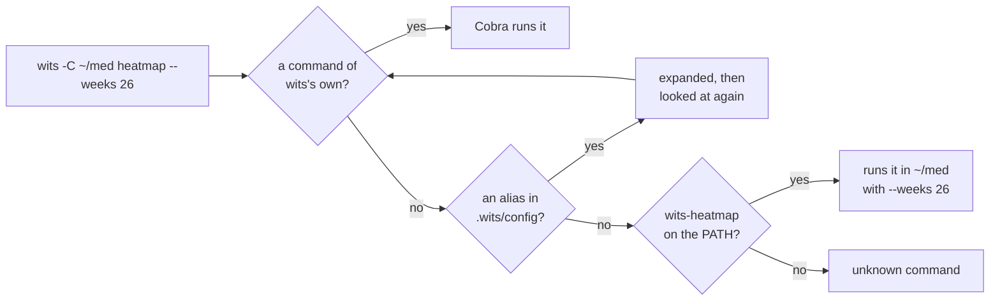

# Cookbook: plugins

<!-- The collapsible sections below are HTML (<details>), which GitHub folds
and unfolds; markdownlint's no-inline-html rule is off for this page alone,
so they can be. -->
<!-- markdownlint-disable MD033 -->

A plugin adds a command to wits without touching its code. Write a program,
name it `wits-<name>`, put it on your PATH, and `wits <name>` runs it. That
is how git finds `git-lfs` and kubectl finds its krew plugins. This chapter
shows the contract, a plugin in six lines of shell, and the three plugins
that come with wits, written in Go.

It builds on [the command line chapter](cli.md), mostly its section on
[scripting with `-o json`](cli.md#65-script-it).

## Contents

1. [How wits finds a plugin](#1-how-wits-finds-a-plugin)
2. [The contract](#2-the-contract)
3. [A first plugin, in shell](#3-a-first-plugin-in-shell)
4. [A plugin in Go](#4-a-plugin-in-go)
5. [The three that come with wits](#5-the-three-that-come-with-wits)
6. [Before you share one](#6-before-you-share-one)

---

## 1. How wits finds a plugin

`commands.Execute` (`cmd/wits/commands/root.go`) looks at the first word
after the global flags. Three things can claim it, in this order:



A command of wits's own always wins, so neither an alias nor a plugin can
ever hide one. `wits get plugins` lists what is on your PATH, and `-o wide`
says which ones never run:

```console
$ wits get plugins -o wide
NAME       PATH                             HIDDEN
heatmap    /home/you/go/bin/wits-heatmap    -
pick       /home/you/go/bin/wits-pick       -
server     /home/you/go/bin/wits-server     -
tolerance  /home/you/go/bin/wits-tolerance  -
```

A `wits-get` on the PATH would be listed too, hidden by "wits get is
wits's own", and so would a second `wits-heatmap` further along the PATH,
hidden by "an earlier one on the PATH".

> [!NOTE]
> `wits-server` is listed too, since its name fits the pattern, so `wits
> server` starts the server. Nothing was written to make that happen; it
> follows from the naming.

All of it is about forty lines in `cmd/wits/commands/plugin.go`:
`plugin()` decides, `runPlugin()` runs, and `plugins()` lists.

---

## 2. The contract

What wits gives a plugin, and what it expects back:

| | |
| --- | --- |
| **Name** | `wits-<name>`, executable, anywhere on the PATH; the first one found wins |
| **Arguments** | everything after `<name>`, as typed: `wits heatmap --weeks 26` runs `wits-heatmap --weeks 26` |
| **Directory** | the plugin runs where `-C` points, or where you are |
| **`$WITS`** | the path of the wits that ran it, so the plugin calls back the same version |
| **`$WITS_DIR`** | the directory it runs in, as an absolute path |
| **Input and output** | the terminal's, unchanged: stdin, stdout and stderr are the plugin's |
| **Exit status** | the plugin's becomes wits's, and wits adds no message |
| **`--dry-run`** | refused before a plugin's name; a plugin that writes takes its own |

A plugin reads the repository the way a script does, through `wits get
<kind> -o json`. It never opens `.wits/` itself: the journal is a
hash-chained log, and a figure only means something after it has been
replayed (`ledger.Fold`). wits does the replay and prints the result.

<details>
<summary><b>The fields each kind prints</b></summary>

| Kind | Fields |
| --- | --- |
| `products` | `slug`, `name`, `maker`, `cultivar`, `thc`, `cbd`, `storage`, `stash`, `avb`, `consumed`, `terpenes` |
| `devices` | `slug`, `name`, `kind`, `maker`, `heat`, `min_temp`, `max_temp`, `usual_temp`, `load`, `retired`, `sessions`, `heated`, `grams`, `last_used` |
| `fills` | `fill`, `opened`, `closed`, `dispensed`, `left`, `products` |
| `sessions` | `hash`, `at`, `product`, `grams`, `device`, `temperature`, `rated`, `scores`, `note` |
| `entries` | every field of a journal entry, as `.wits/journal.ndjson` holds it |
| `plugins` | `name`, `path`, `hidden` |

Grams are grams, as decimals. Times are RFC 3339. `scores` is a session's
rating as numbers, `{"overall": 4, "sleep": 5}`; `rated` says the same
thing as text. A field that is empty is left out.

</details>

---

## 3. A first plugin, in shell

What is left of the newest fill, in one line, for a status bar:

```sh
#!/bin/sh
# wits-left: what is left of the newest fill, in one line.
"${WITS:-wits}" get fills -o json | python3 -c '
import json, sys
f = json.load(sys.stdin)[-1]
print("%.2f g left of fill %d" % (f["left"], f["fill"]))'
```

Save it as `wits-left` in a folder on your PATH and make it executable:

```console
$ chmod +x ~/bin/wits-left
$ wits -C /tmp/demo left
36.73 g left of fill 30
```

`"${WITS:-wits}"` calls back the wits that ran it, or the one on the PATH
when you run `wits-left` by hand. That is the whole contract in use: a name,
a JSON list, and plain output.

---

## 4. A plugin in Go

The three plugins in `plugins/` are each a `main` package, built apart from
wits. They share one small package, `plugins/internal/wits`, with the shapes
they read and a `Get` that calls back:

```go
// Get runs `wits get <kind> -o json`, with any more flags, and reads what
// it prints into v.
func Get(v any, kind string, flags ...string) error {
    bin := cmp.Or(os.Getenv("WITS"), "wits")
    args := append([]string{"get", kind, "-o", "json"}, flags...)
    var out, errs bytes.Buffer
    c := exec.Command(bin, args...)
    c.Stdout, c.Stderr = &out, &errs
    if err := c.Run(); err != nil {
        return fmt.Errorf("wits %s: %s", strings.Join(args, " "), cmp.Or(strings.TrimSpace(errs.String()), err.Error()))
    }
    return json.Unmarshal(out.Bytes(), v)
}
```

The structs list only the fields a plugin reads. `encoding/json` ignores
the rest, so a field wits adds later breaks nothing.

Every plugin has the same shape: `main` parses flags and fetches, and
everything after that is a function of plain data. `wits-tolerance` is the
smallest:

```go
func main() {
    months := flag.Int("months", 12, "how many months back, this one included")
    threshold := flag.Float64("threshold", 15, "the rise, in percent, that counts as creeping")
    flag.Parse()
    var sessions []wits.Session
    if err := wits.Get(&sessions, "sessions"); err != nil {
        wits.Fail(err)
    }
    render(os.Stdout, tally(sessions, time.Now(), *months), *threshold)
}
```

`tally` takes the sessions and a "now", and `render` takes an `io.Writer`.
So the test needs no wits and no repository: it builds sessions in memory,
fixes the date, and reads what was written.

```go
func TestTolerance(t *testing.T) {
    now := time.Date(2026, 11, 3, 12, 0, 0, 0, time.Local)
    // … ten sessions a month, 0.2 g for three months, then 0.25 g …
    ms := tally(sessions, now, 6)
    assert.Contains(t, verdict(ms, 15), "25% more than three months before (0.250 g, was 0.200 g)")
}
```

Build and try them:

```sh
make plugins && export PATH=$PWD/bin:$PATH
wits get plugins
```

`make install-plugins` puts them in `$GOBIN` to keep. Someone without the
source can run `go install github.com/TheDonDope/wits/plugins/...@latest`.

---

## 5. The three that come with wits

All the output below is from the demo repository (`wits clone
assets/demo-seed.wits /tmp/demo`).

### `wits heatmap`

The sessions as a calendar: a column a week, a row a weekday, each day
shaded by the quarter of days it falls in. `--weeks 26` for half a year,
`--count` to shade by sessions instead of grams.

```console
$ wits heatmap --weeks 26
       Jun  Jul Aug  Sep Oct Nov
Mon ······█▒·▒▓▓█░▓▒░▓·▒█·█···
    ······▓█·░▓▒▒·█·░░·▓█·▓▒··
Wed ······▓·░····░░····░█░·▒·
    ·····░░·░···········▓▒·▒·
Fri ·····░··▓··░░▒·▒░▒··░▓·▒·
    ·····█░·░·▒▓██▓▒▓·▒▒·▓▓▒·
Sun ·····█▒·████▓█▓██░▒··██▒·

    less · ░ ▒ ▓ █ more (grams a day)

262 sessions, 61.43 g in 26 weeks: a session on 83 of 177 days; the longest break, 38 days.
```

The shades are quartiles of the days that had a session, not fixed amounts.
A light user and a heavy one both get the whole scale.

### `wits tolerance`

The grams a session takes, month by month. It then compares the last three
months, pooled, with the three before them. `--threshold` is the rise, in
percent, that counts as creeping (15 by default).

```console
$ wits tolerance --months 6
MONTH    SESSIONS  GRAMS    G/SESSION  CHANGE
2026-06  36        7.92 g   0.220 g    -    ██████████████████
2026-07  47        11.21 g  0.239 g    +8%  ████████████████████
2026-08  71        17.19 g  0.242 g    +2%  ████████████████████
2026-09  61        13.87 g  0.227 g    -6%  ███████████████████
2026-10  47        11.24 g  0.239 g    +5%  ████████████████████
2026-11  0         0.00 g   0.000 g    -

Steady: a session takes 0.233 g, -1% on three months before.
```

The months are pooled, the grams added up and divided once, so a month with
four sessions weighs less than one with seventy.

### `wits pick`

Tonight's jar. Every product holding something is scored by how your rated
sessions of it went, above or below your average. To that is added how the
sessions of every strain sharing its terpenes went. `--for sleep` ranks by
one score instead of `overall`. `--min` is the number of rated sessions a
terpene needs before it counts (3 by default).

```console
$ wits pick --for sleep --top 1
Tonight, for sleep (492 rated sessions, 4.4 of 5 on average):

1. NICE 32/1 Morning Sun (nice-morning-sun-321): +0.56
   3.40 g ground, 11.37 g sealed
   you rated it 5.0 over 14 sessions
   its terpenes: Limonene +0.01, Myrcene +0.02, Terpinolene -0.07
```

Each line says what the score stands on, so you can see when it is the
jar's own record and when it is only the company its terpenes keep. A jar
nobody has rated, which shares no rated terpenes, is not ranked at all.

---

## 6. Before you share one

- [ ] It reads only `wits get … -o json`, never `.wits/` itself.
- [ ] It calls back `$WITS`, falling back to `wits` on the PATH.
- [ ] Its name isn't a command of wits's own (`wits get plugins -o wide`
      would say so).
- [ ] It exits non-zero when it fails, with the reason on stderr.
- [ ] It says something plain when there is nothing to show yet: no
      sessions, no ratings.
- [ ] One that writes goes through wits's own commands (`wits rate session`,
      `wits weigh`), so the recorder's checks apply. Offer `--dry-run` by
      passing it on to them.
- [ ] In this repository: a test of its arithmetic on fixed data, a row in
      `docs/terminal.md`'s plugin table, and `./preflight.sh` green.

<details>
<summary><b>Where things are</b></summary>

| File | Holds |
| --- | --- |
| `cmd/wits/commands/plugin.go` | Finding, running and listing plugins; `Exit` |
| `cmd/wits/commands/root.go` | `Execute`: builtins, then aliases, then plugins |
| `cmd/wits/main.go` | Passes a plugin's exit status on as wits's own |
| `plugins/internal/wits` | `Get`, `Fail`, and the `Session` and `Product` shapes |
| `plugins/wits-heatmap`, `wits-tolerance`, `wits-pick` | The three plugins, each with its test |

</details>
