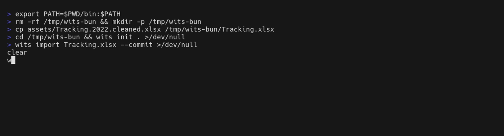

# Wits in the terminal

The command line and the terminal interface: everything wits does, in a shell.
[The README](../README.md) gets it installed; the browser and the phone are in
[Wits in a browser](./browser.md). Inside the browser, **User guide** on the
header's menu (⋮) walks through every page, with the command beside each that
does the same here.

- [Recording, day to day](#recording-day-to-day)
- [The terminal interface](#the-terminal-interface)
- [Commands](#commands)
- [Bringing a spreadsheet across](#bringing-a-spreadsheet-across)
- [Correcting a mistake](#correcting-a-mistake)
- [When the ledger and the scale disagree](#when-the-ledger-and-the-scale-disagree)
- [The repository](#the-repository) · [Bundles](#bundles) · [More than one device](#more-than-one-device)
- [For the prescriber](#for-the-prescriber) · [A chain others can check](#a-chain-others-can-check) · [What I carry](#what-i-carry)
- [Packing for a trip](#packing-for-a-trip) · [The year, on one card](#the-year-on-one-card)
- [What it costs](#what-it-costs) · [AVB](#avb) · [Temperatures](#temperatures)

## Recording, day to day

Tab completion offers the handles, with the full name and how much is left
beside each — and only the ones the command can act on, so `sesh` offers what is
in a stash rather than everything ever dispensed:

```console
$ wits grind <TAB>
lcook-281   17.10 g · Cannamedical 28/1 Lemon Cookie
mac1-251    15.00 g · Cantourage 25/1 MAC1+
wcake-221   16.90 g · Enua 22/1 Wedding Cake
```

Completion is a script the shell sources, written by `wits completion bash`
(or `zsh`, `fish`). Bash only runs it through the `bash-completion` package,
which is not always preinstalled — without it the script loads silently and
does nothing. Install that first, give it the directory it reads user
completions from, and write the script there:

```sh
sudo pacman -S bash-completion   # or apt/dnf install bash-completion,
                                 # brew install bash-completion@2
mkdir -p ~/.local/share/bash-completion/completions
wits completion bash > ~/.local/share/bash-completion/completions/wits
```

A new shell picks it up from there; nothing needs sourcing in `.bashrc`, and
no `sudo` was involved. To try it in the current shell without writing
anything: `source <(wits completion bash)`. Zsh wants the script on its
`fpath` as `_wits`, fish in its own completions directory:

```sh
wits completion zsh > "${fpath[1]}/_wits"                    # zsh
wits completion fish > ~/.config/fish/completions/wits.fish  # fish
```

Anything can be backdated with `--date 2026-07-29`, which is what makes a
forgotten evening loggable the next morning without pretending it was entered
then. Without it the entry is dated now. A fill can be dated however far back,
and lands where its date puts it — a fill entered a month late opens its own
cycle a month back. Nothing is dated ahead: the journal records what happened,
so an entry is written once it has. Grinds and sessions are held to what was
there on their date: a grind dated before the fill it draws on is refused.

```console
$ wits status
On cycle 30, opened 2026-08-29 (day 57)

PRODUCT                       STORAGE  STASH  AVB    LEFT
nice-morning-sun-321          11.37g   8.63g  0.00g  57%
all-nations-mac-doughnut-291  12.42g   7.58g  0.00g  62%
sumo-papaya-bomb-251          12.94g   7.06g  0.00g  65%

total                         36.73g                 61%

36.73g of 60.00g left over 55 days, 23 of them with an entry
8.07g more in 2 older jars, 1 earlier cycle still open
1.93g per active day, 1.69g median, 0.81g per elapsed day
About 19 days' worth at that rate
Order the next prescription by Sat 14 November, with 3 days for the pharmacy.
Today: no session yet.
```

Every gram in storage stands on the account of the cycle that dispensed it,
so the total is the fill's own: 36.73 g of the 60 g this prescription
brought. What older cycles still hold gets its own line — those cycles are
simply still open. A jar refilled before it was empty holds two cycles'
grams, and grinding draws the oldest first, the way inventory leaves a
shelf.

The last line is the refill planner. The shelf, 44.80 g in every jar, runs
out on 17 November at the fill's 1.93 g a day, and the pharmacy needs its lead
time before that. `wits refill` says it at length, `--lead 5` changes the lead
time and keeps it, and `--ics refill.ics` writes a calendar reminder for the
morning of the day to order by. The dashboards say it under their projection
of the supply.

```console
$ wits refill --ics refill.ics
44.80 g on the shelf, at 1.93 g a day with grinding: empty on Tue 17 November.
Order the next prescription by Sat 14 November, with 3 days for the pharmacy.
Wrote a reminder for 2026-11-14 to refill.ics
```

### Today, and the THC in it

The last line of `wits status` is the day so far, and `wits today` has it at
length: every session with the THC and CBD in the grams put through the
device — grams × the strain's per cent × 10, in milligrams, so 0.15 g of a
32 % strain is 48 mg — their sum, and a usual day of the last 30 with a
session. It is what was in the material, not what reached the body: a
vaporizer releases part of it, and a lung takes in part of that. A strain
with no THC written down is counted, not guessed at. `--date 2026-10-24` for
another day.

```console
$ wits today
Monday 26 October: 4 sessions, 0.67 g through a device: 206 mg THC and 7 mg CBD in the material

TIME   PRODUCT                DEVICE                           GRAMS  THC      CBD     RATED
07:50  NICE 32/1 Morning Sun  Storz & Bickel Venty at 180°C    0.15g  48.0 mg  1.5 mg  4 of 5
09:30  Sumo 25/1 Papaya Bomb  Storz & Bickel Mighty+ at 190°C  0.22g  55.0 mg  2.2 mg  -
11:05  Enua 36/1 Citrus Slap  Limelight Herb Frolic at 175°C   0.18g  64.8 mg  1.8 mg  5 of 5
12:20  NICE 32/1 Morning Sun  Storz & Bickel Venty at 185°C    0.12g  38.4 mg  1.2 mg  -

Ground 0.60 g. A usual day of the last 30 with a session: 0.83 g, 239 mg THC (21 days).
```

## The terminal interface

`wits` on its own opens the interface: a dashboard of cards — storage, stash,
sessions, devices, two rhythm calendars and a projection of the supply's
decline to its empty day — then the journal, an analysis view scoping from the
current cycle out to the whole history, the storage, the stash, the sessions,
and the devices. `tab` moves between them. Entries can be recorded
there too — `b` for a fill, `g` to grind, `s` for a session, `r` to weigh, `$`
to price the purchases still without one — and `?` lists every key the current screen honours. `q` quits; `esc` only ever
closes the form in front.

The interface keeps up with the repository: an entry made with a command in
another terminal shows within a second, and at midnight "today" moves on.

`t` picks a theme: wits' own, which follows the terminal's light or dark
background, or one of twenty editor themes — Dark+ and Light+, One Dark Pro,
Dracula, Monokai, Darcula, Solarized Dark and Light, Nord, Gruvbox Dark, Tokyo
Night, Catppuccin Mocha and Latte, GitHub Dark and Light, Night Owl, Material
Palenight, Ayu Dark, Cobalt2 and Rosé Pine. The screen follows the cursor as it
moves; `enter` keeps the theme and saves it to `config.yml`, `esc` puts the old
one back. An editor theme repaints the terminal's background the way the
editor would, and the terminal gets its own colours back when wits exits.

The analysis view draws the daily amounts as a braille area chart with a
seven-day average riding over it, and the longer scopes as a calendar heatmap —
one cell per day, colour carrying the amount — so a year of habit reads the way
a contribution graph does: the heavy weeks, the pauses, whether weekends
differ. `s` changes the scope.

Because everything is replayed from the log, the analysis, storage and stash
screens can start from empty and grow the way the record grew: `p` plays,
`←/→` steps an entry at a time, and `+/-` retunes the speed.

## Commands

| | |
| --- | --- |
| `wits init [dir]` | Create a repository |
| `wits buy <product> <amount>` | Record a prescription fill, `--slug` to name it, `--price` for what it cost |
| `wits price <purchase> <euros>` | Write down what a purchase cost; `wits reconcile purchases` walks every one without |
| `wits costs` | What the prescriptions cost: per gram, by fill, by month, and per session that helped |
| `wits describe <product>` | What is known about a product; `--name`, `--maker`, `--cultivar`, `--thc`, `--cbd` correct its label, the slug kept; `--terpenes` writes down its profile, dominant first; `--rating "overall=4 taste=5" --again yes` rates the strain as a whole |
| `wits like <product>` | The products most like one, by name, cannabinoids and terpenes |
| `wits grind <product> <amount>` | Move product from storage into its stash |
| `wits sesh <product> <amount>` | Record a session, drawing on the stash; `--device`, `--temp`, `--mode`, `--timer`, `--heater`, `--setting`, `--note` |
| `wits avb collect <grams>` / `use <grams>` | AVB weighed out of a device, or used up; `wits avb` for the jar and every yield |
| `wits rate <session\|last> <dimension=1–5>…` | Rate what a session did; `--note` |
| `wits status` | What is left, and how long it will last |
| `wits today` | The day so far: every session with the THC and CBD in it, their sum, and a usual day; `--date` for another |
| `wits refill` | When to order the next prescription; `--lead` for the pharmacy's days, `--ics` for a reminder |
| `wits log` | The journal, newest first; `--oneline`, `-n`, `--product`, `--current` |
| `wits show [entry]` | One entry in full: what it moved, the jar before and after, what corrects it |
| `wits revert <entry>` | Undo an entry by recording a correction |
| `wits amend <entry> <grams>` | Correct an entry's amount: undone and recorded again, in one write; `--note` |
| `wits reconcile [account] [product] [weight]` | Make an account agree with the scale; interactive with no arguments |
| `wits device add <name>` / `edit <device>` / `remove <device>` / `list` | Register a vaporizer, its temperature range and its load (`--load 0.15`); change what the flags say; take it out of the catalog, its sessions keeping its name; list them |
| `wits temps <celsius>` | What a temperature is hot enough to release |
| `wits import <file.xlsx>` | Import a tracking spreadsheet; a dry run without `--commit` |
| `wits export` | The current cycle as Markdown; `--all` for every cycle, `--from`/`--to` for a range of days, `--site <dir>` for GitHub Pages |
| `wits report` | One page for the prescriber, as a PDF; `--from`/`--to`, the last 90 days by default |
| `wits bundle` | The whole repository as one compact file; `--gzip` to compress it |
| `wits restore <file>` | Rebuild a repository from a bundle |
| `wits remote add <folder>` | Share the repository through a folder; `--key` on every device after the first |
| `wits push` / `wits pull` | Write the repository to the folder; bring in what other devices wrote there |
| `wits fsck` | Check the journal and the catalogs for damage |
| `wits seal` | Sign the journal's head; `--timestamp` anchors it with OpenTimestamps, `--upgrade` fetches the proof |
| `wits verify <file.seal>` | Check a seal, or a statement from `wits carry`: its signature, the journal it seals, its timestamp |
| `wits carry` | What is held, against the fills that dispensed it, signed; `--out` a QR code (.svg, .png) or the statement (.txt) |
| `wits pack --days <n>` | What to take on a trip, from which jars, signed for exactly that; `--margin`, `--oldest`, `--out` |
| `wits review [year]` | The year on one card: the grams, the strains, the longest break, the best temperature, the dearest gram |
| `wits completion <shell>` | The tab-completion script for bash, zsh or fish |

Every command takes `--help`, and `buy`, `grind` and `sesh` take `--date`.

## Bringing a spreadsheet across

`wits import` reads a tracking workbook and turns each worksheet into a
prescription fill and the grinds that followed it. The default is a dry run: it
reports what it would record, and anything about the spreadsheet that does not
add up, so years of history can be checked before any of it is written.


Products are resolved **by position**, through the bindings in the running
balance formulas, rather than by the label in the strain column — those labels
are dropdown values that were not always renamed as products changed. On the
records this was written for, every one of the 1209.20 g ground is placed
through a binding, never through a label.

An import only goes into an empty repository: a second one would double every
gram, and could not be told apart from a second helping of the same product on
the same day. It says what it is doing as it goes, timed, on stderr — reading
the workbook, adding the products, writing the entries — and writes every entry
in one go: an entry that does not validate refuses the import before anything
is written.

## Correcting a mistake

Nothing is edited in place. An entry is undone by recording a correction that
moves the same grams back the way they came, so both stay in the log:

```sh
wits log --oneline -n 1
wits revert 8297238 --reason "misread the scale"
wits amend 8297238 0.75 --note "misread the scale"
```

`wits amend` undoes the entry and records it again with the amount it should
have had, both in one write, and refuses an amount the jar never held. In the
journal, `e` amends an amount and `d` undoes an entry. The log shows
what currently stands; `v` reveals the corrections behind it, `f` filters it,
and `←/→` browses the entries as cards.

The storage screen is two tables: what still holds something, and the history
of every jar weighed down to zero, newest first. The stash screen drills into
the ground product the same way — the stashes holding something above, and
under them every stash worked down to nothing, grouped under the day it was
consumed. The sessions screen tells the other half of the story: how much came
out of the stash, when, through which device and how hot, drawn with the same
charts the analysis view uses. Its newest sessions are listed with what each
was rated; `e` rates the one under the cursor — a line a dimension, `←`/`→` or
`1`–`5` to score, `0` to leave one out — and under the list each product's
overall rating, with how many ratings it stands on. Space ticks jars in either table and `r` weighs
the ticked ones together; `e` corrects a product's label — name, maker,
cultivar, THC, CBD, terpenes; `R` rates the strain as a whole — overall, taste,
aroma, whether again, a line — opened on its standing rating; `c` records stale stash
remainders from earlier cycles as consumed, which is what four imported years of
grind-only records leave behind. Product names are never abbreviated — the name
column takes what the longest name needs.

## When the ledger and the scale disagree

Ledgers drift. A little is spilled, a session goes unlogged, a scale is read
wrong. The past is not edited to hide it, because nobody knows which entry was
wrong — instead the difference is recorded, and the account agrees with the jar
again:

```console
$ wits reconcile storage wcake-221 16.5 --dry-run
storage holds 16.90g by the ledger and 16.50g on the scale: -0.40g

Dry run. Nothing was written. Re-run without --dry-run to record it.

$ wits reconcile storage wcake-221 16.5 --reason "spilled on the desk"
[4b36264] adjusted 0.40g out of storage of wcake-221, now 16.50g
```


For weighing day, `wits reconcile` on its own is interactive. Pick the account
on the scale (storage, the stash, or the AVB once it holds anything) and tick
the jars to weigh, all of them by default. Each is asked for in turn, with the
ledger's figure beside the prompt, and a blank reading skips a jar; `wits reconcile stash` skips the first question. Nothing is
written until every question is answered. In the interface this is `r`, on any
screen — it weighs the jars ticked on the storage screen, the one under the
cursor, or otherwise the fullest one, since that is the one worth checking.

### Forgotten, not lost

Grams do not vanish. A jar lighter than the ledger says was most likely
ground, and the grind never recorded; ground grams that are gone were most
likely vaped. So a reading short of the ledger is offered as what was
forgotten — the interactive form asks, `Forgotten` the default, and
`--forgot` says yes up front:

```console
$ wits reconcile storage nice-morning-sun-321 10.5 --dry-run
storage holds 11.37g by the ledger and 10.50g on the scale: -0.87g
Forgotten rather than lost? --forgot records a grind of 0.87 g on Fri 23 Oct, just after the jar's last entry.

$ wits reconcile storage nice-morning-sun-321 10.5 --forgot
[9a12b3c] forgotten grind of 0.87g of nice-morning-sun-321, Fri 23 Oct 00:01
Now weigh what is ground: wits reconcile stash nice-morning-sun-321 <weight>

$ wits reconcile stash nice-morning-sun-321 7.5 --forgot --dry-run
nice-morning-sun-321: would record 13 sessions of about 0.15 g, 23 Oct – 26 Oct, with the Storz & Bickel Mighty+
```

A forgotten grind is dated just after the jar's last entry, and forgotten
sessions are spread from then until now, so no entry already recorded loses
a gram to them. A session takes the size your last thirty sessions most often
took, had as the last one was — its device, mode and temperature. With no
session on record it takes a **load** of your gear (`wits device add
<name> --load 0.15`), and with none of that, one a day. A shortfall that
would take more than 30 sessions is a leftover, or lost, and is refused as
forgotten. Each entry carries the note "forgotten, worked out at the scale",
and a predicted session is never asked to be rated. In the interface the
weighing forms ask the same question.

## The repository

```text
.wits/
  config.yml      # settings — the interface theme
  products.yml    # the catalog
  devices.yml     # vaporizers and their temperature ranges
  journal.ndjson  # append-only, one entry per line; a pull appends too
  effects.ndjson  # the effect log: ratings of sessions, append-only too
  prices.ndjson   # the price log: what each purchase cost, append-only too
  remote.key      # the age key the remote is encrypted to; never in the remote
  seal.key        # the key seals are signed with; yours, and in no bundle or remote
  seals/          # the seals of the journal's head, and their timestamp proofs
  *.lock          # empty; what two writers of one file take turns on
```

The catalogs and the config are rewritten whole, so they are written to a
temporary file and renamed into place — a crash leaves the old file or the new
one, never an empty one — and every change to one is made under its lock, onto
the file as it stands: a product added in one terminal survives a rename made
in the TUI from a copy read before it.

The journal is only ever appended to, and each entry is chained to the one before
it with a SHA-256 hash, so an edit made outside Wits is detectable. Appending
takes an advisory file lock as well as a mutex, because it is a read-then-write
and two processes reading the same tip would fork the chain. The checks an entry
must pass — enough in the jar, not already undone — run inside that lock against
the journal as it stands, so the TUI and a command in another terminal cannot
both take the same grams. A write cut off before its newline — a crash, a full
disk — is left out when reading, and cut away before the next entry is appended.

The chain is checked every time a repository opens. If the journal was changed
outside Wits, `wits status` and the interface say so, and `wits fsck` says
where — along with any entry that took grams that were not in the jar at the
time, any entry naming a product or device the catalogs lack, and whether every
gram that came in is in the jars, through a vaporizer, or went out:

```console
$ wits fsck
1429 entries, 53 products, 1 device
1254.00 g came in, 0.00 g went out; 1254.00 g in the jars — every gram accounted for
✓ the chain verifies, and nothing is out of place
```

The directory is created `0700` and its files `0600`. Nothing is transmitted
anywhere unless you ask. `wits push` writes to a folder you name, encrypted, and
what carries the folder further is yours to choose. `wits seal --timestamp`
is the one network call wits makes, and only when asked. It sends one SHA-256,
the seal's hash and nothing else, to the public OpenTimestamps calendars.

## Bundles

`wits bundle` writes the catalogs and every entry to a single file that
`wits restore` reads back, reproducing the journal **exactly, hash chain
included**. That is what makes it worth trusting as a backup. A restore writes
every entry in one go and checks the chain it made; a bundle that does not
restore whole restores nothing. Bundles written before v0.41.0 left out the
accounts of undos and weighings; they are recovered when such a bundle is
restored, and one that cannot be recovered is refused rather than restored
wrong. The effect log, the price log and the seals with their timestamps
travel in the bundle too, after the entries, and each product's terpenes with it
(format 6; an older build refuses one, rather than dropping what it cannot
read).

It is plain text, so the record stays legible with nothing but a text editor and
diffs cleanly in git. Small, too, because most of what the journal stores is
derivable and is left out: sequence numbers, account pairs and the whole hash
chain are recomputed on restore.

Three years of real history, 1429 entries across 53 products:

| | bytes | |
| --- | ---: | --- |
| journal | 528,321 | |
| **bundle** | **29,417** | **18×** |
| bundle, `--gzip` | 6,693 | 79× |



## More than one device

`wits push` and `wits pull` keep one repository on several devices through a
folder they can all reach: a Syncthing share, a USB stick, anything that
carries files. The folder holds one file, `wits.age`: the repository as a
compressed bundle, encrypted with [age](https://age-encryption.org) to a key
in `.wits/remote.key`. The key never goes in the folder. Bring it to each other
device yourself, and pass it to `wits remote add --key` there. The whole
workbook, 1429 entries, is 6,911 bytes in the folder.

```console
$ wits remote add ~/Sync/wits
Remote set to ~/Sync/wits. Its key is ~/wits/.wits/remote.key: bring it to every other device, and nowhere else.
$ wits push
Pushed 1429 entries and 0 ratings.
$ wits pull   # on the phone
Pulled 1429 entries and 0 ratings.
Took the remote's 53 products and 0 devices.
$ wits push   # on the deck, after both recorded a grind
🚨 the remote holds entries this device does not: wits pull first
$ wits pull
Pulled 1 entry and 0 ratings.
Merged with this device's own, which keep their hashes.
$ wits push
Pushed 1 entry and 0 ratings.
```

A pull works the way `git merge` does. The remote's entries this device lacks
are appended as they are, and when both devices recorded, a merge entry
follows, naming both heads. Nothing is chained again: every entry keeps its
hash on every device, so what rates, prices or undoes it, and a seal made
before the sync, still name it. A push is refused until the device holds
everything on the remote, so nothing another device wrote is written over.
Products and devices merge field by field: where both changed one, the later
change stands, and a rename or a terpene profile written here and not yet
pushed is kept.

Two devices can each record the same last grams of a jar. Both entries are
kept as written, and `wits pull`, `wits status` and `wits fsck` name the one
that took grams that weren't there. The jar takes nothing more except an undo
until one of the two is reverted with `wits revert`. Every other jar records
as usual.

## For the prescriber

`wits report` writes one page for an appointment, as a PDF. It covers the days
asked for (the last 90 unless `--from` and `--to` say otherwise): grams a day,
with grinding and per calendar day, the weeks as bars, which strains, what the
sessions did by the effect log, each mean with the count it stands on, and
today's fill and shelf with the date the next prescription is due. The footer
names the head of the journal's hash chain. The browser's History page
downloads the same file, and a phone hands it over to share.

```console
$ wits report --from 2026-08-01 --to 2026-10-24
Wrote a report for 2026-08-01 to 2026-10-24 to wits-report-2026-10-24.pdf
```


Its figures are the range's own, the same `wits export --from --to` gives:
67.56 g ground on 33 of the 85 days. The PDF is written by wits itself, in the
Helvetica every reader has, and this one is 5,004 bytes.

## A chain others can check

The journal is hash-chained, so its last hash fixes everything before it.
`wits seal` signs that hash with a key of your own (Ed25519, made the first
time in `.wits/seal.key`). `--timestamp` has the OpenTimestamps calendars
commit the seal's hash into Bitcoin, which proves it existed by a time nobody
can move. A doctor or an authority can then check a report against the journal
without trusting the patient or wits: the report's footer names the seal and
the key's fingerprint, `wits verify` checks the seal, and `ots verify` or
opentimestamps.org check the `.ots` proof with no wits at all.

```console
$ wits seal --timestamp
Made a sealing key in .wits/seal.key; its fingerprint is SHA256:t3GaiTSwisPSicN8ccsjAcVflyo7R9oxCglLYSluQQM
Sealed the journal's 1429 entries, head 1639d82, as 2026-10-24-1639d829b7e8.seal
Sent the seal's SHA-256, and nothing else, to 4 calendars; the proof is 2026-10-24-1639d829b7e8.ots, pending until it is in a block.
$ wits verify .wits/seals/2026-10-24-1639d829b7e8.seal
✓ signed by SHA256:t3GaiTSwisPSicN8ccsjAcVflyo7R9oxCglLYSluQQM on 24 October 2026, 22:13
✓ the journal here holds what was sealed: 1429 entries, up to 1639d82
· timestamp pending at 4 calendars; `wits seal --upgrade` asks for it again
```

A seal is six lines of text: the head, how many entries it closes, when, the
public key, and the signature over the lines before it. Hand out the key's
fingerprint (`wits seal --key`) once, to the person who checks, and never the
key file. A proof is pending for a few hours until a calendar's commitment is
in a block; `wits seal --upgrade` then fetches it. `wits report --seal` seals
the head before writing the page, so the page names the seal it can be
checked against. Seals travel in bundles and through push and pull, and fsck
checks every one: its signature, its head in the journal, and its proof.

## What I carry

In Germany a patient must be able to show that what they carry is what was
prescribed. `wits carry` lists what is held, each product sealed, ground and
already vaped, against the fills that dispensed it. It signs that with the
sealing key, as a statement that names the journal's head, and writes it as a
QR code:

```console
$ wits carry --out carry.svg
Held on 25 October 2026, 00:07, by the journal's 1429 entries up to 1639d82:

PRODUCT                            SEALED  GROUND  AVB    DISPENSED
Sumo 25/1 Papaya Bomb              12.94g  7.06g   0.00g  20.00g on 2026-08-29
All Nations 29/1 Mac Doughnut      12.42g  7.58g   0.00g  20.00g on 2026-08-29
NICE 32/1 Morning Sun              11.37g  8.63g   0.00g  20.00g on 2026-08-29
420 Evolution 27/1 Ice Cream Cake  5.67g   14.33g  0.00g  20.00g on 2026-07-09
Enua 36/1 Citrus Slap              2.40g   17.60g  0.00g  20.00g on 2026-07-09

100.00g in all. Signed by SHA256:t3GaiTSwisPSicN8ccsjAcVflyo7R9oxCglLYSluQQM; the QR code opens it at https://thedondope.github.io/wits/verify.html
```

Scanned with any phone, the code opens a page that checks the signature in
that browser and lists the holdings. The statement rides after the `#`, which
a browser never sends to the server, so GitHub never sees it, and the page
stores and sends nothing. It is plain HTML, uses the browser's own Ed25519
where it has one and its own where not, and works offline once the app is
installed. The browser shows the same code under **What I carry** on the Jars
page. Only the products on the shelf are listed unless `--all` says every jar
holding anything: a stash the record never worked down (the imported history
has no sessions) is the ledger's, not what is in a pocket.

The signature says who signed it. Whose key that is, the person checking
learns from the fingerprint the patient gave their doctor, or the one on a
sealed report. A phone makes a key of its own the first time, so its
fingerprint differs from the computer's until the computer's
`.wits/seal.key` is brought to it.

## Packing for a trip

`wits pack --days 10` is what to take for ten days away: the days at the rate
the refill planner runs on, this fill's grams a day with grinding, with
`--margin` per cent on top (20 unless given), rounded up to a tenth of a
gram. It is drawn from the jars on the shelf evenly, every jar giving about
the same grams, so the trip has a mix of them and the jars go down together;
each jar's ground grams go before its sealed ones. `--oldest` takes the
oldest fill's jars first instead. Nothing is recorded: grind what the plan
says to, as usual.

```console
$ wits pack --days 10
Take 23.20 g: 10 days at 1.93 g a day, with 20 % to spare.

PRODUCT                            GROUND  SEALED  TAKE   DAYS  LEFT
420 Evolution 27/1 Ice Cream Cake  4.60g   0.00g   4.60g  2.4   7.07g
Enua 36/1 Citrus Slap              4.60g   0.00g   4.60g  2.4   5.01g
All Nations 29/1 Mac Doughnut      3.30g   1.40g   4.70g  2.4   11.02g
NICE 32/1 Morning Sun              3.40g   1.20g   4.60g  2.4   10.17g
Sumo 25/1 Papaya Bomb              2.26g   2.44g   4.70g  2.4   10.50g

Drawn evenly, about the same from every jar, ground before sealed. Grind the sealed grams before you go.
```

The plan is signed as a statement of what is carried, the way `wits carry`
signs the shelf, but for exactly the grams packed: `--out trip.svg` writes
its QR code, `--out trip.txt` the statement, and `wits verify` checks either.
A shelf that holds less than the trip wants says so, and packs it all.

## The year, on one card

`wits review` is the year in wits, to today in a year still running;
`wits review 2025` a year gone by. Every figure is the year's own, and is one
the report, the effect log or the price log already computes: the grams and
the days, month by month, the strains, the busiest day, the longest break (a
week or more with nothing ground and no session, the tolerance curve's rule),
the temperature band rated best overall (on five ratings at least), the
strain rated best, the device most used, the terpene most of the grams led
with, and what it cost, from the cheapest gram to the dearest.

```console
$ wits review 2025
╭─────────────────────────────────────────────────────────────╮
│  2025 in wits                                               │
│  446.34 g ground on 221 of 365 days · 2.02 g an active day  │
│  11 prescriptions · 309 sessions · 25 strains               │
╰─────────────────────────────────────────────────────────────╯

  Jan  █████████████▍                    28.36 g
  Feb  ██████████████▏                   30.00 g
  Mar  ██████████████▏                   30.00 g
  Apr                                     0.00 g
  May  █████████▎                        19.73 g
  Jun  █████████████████████▌            45.68 g
  Jul  ███████████████▎                  32.43 g
  Aug  ███████████████████▊              42.07 g
  Sep  █████████████████████▎            45.13 g
  Oct  ███████████████████████▌          49.96 g
  Nov  █████████████████████████▉        55.00 g
  Dec  ████████████████████████████████  67.98 g  ← the most

  Strains              1  Cannabis 1A 16/1 White Widow, 58.36 g (13 %)
                       2  Cannamedical Hybrid Classic 18/1 MAC 3, 50.00 g (11 %)
                       3  Cantourage 25/1 MAC 1+, 40.00 g (9 %)
  Busiest day          Tue 2 December, 8.10 g ground
  Longest break        53 days, 21 March to 12 May (2 breaks in all)
  Best temperature     190–199 °C, 4.2 overall over 67 ratings
  Rated best           Cannamedical Hybrid Classic 18/1 MAC 3, 4.5 overall over 76 ratings
  Most used            Storz & Bickel Venty, 130 sessions and 30.96 g
  Terpene of the year  Limonene — citrus, lemon, orange, 60 % of the grams ground
  Paid                 3203.10 € for 460.00 g with a price, 6.96 € a gram
  Dearest gram         10.99 €, Pedanios 22/1 DNK Ghost Train Haze on 6 February
  Cheapest gram        3.99 €, Canopy Bakerstreeet 22/1 Hindu Kush on 30 September
```

The browser draws the same, with more room: **Insights → Year**.

## What it costs

A price goes beside the journal, in `.wits/prices.ndjson`, because a purchase
is never edited and a price moves no grams. Give it when buying, afterwards, or
in one sitting for every purchase still in storage without one:

```console
$ wits price 52b8 "180,00 €" --note "the label said 180"
[ea22d7e] 180.00 € for 20.00g of sumo-papaya-bomb-251 on 2026-08-29, 9.00 € a gram
$ wits reconcile purchases          # one question a purchase; --all for every one
$ wits costs
520.00 € for 60.00g with a price, 8.67 € a gram; 85 purchases without one

FILL  DISPENSED   GRAMS   PAID      A GRAM
30    2026-08-29  60.00g  520.00 €  8.67 €
29    2026-07-09  60.00g  -         -       3 purchases without a price
…
1 session that helped (4 or more overall), 3.40 € each on average.
```

These figures are the ones from pricing the workbook's fill 30 by hand at 170 €
and then 180 € a jar; the workbook itself has no prices. A purchase priced
again costs what it was priced at last, and the log keeps both. Only purchases
with a price count. How many have none is said, not guessed at. A session that
helped is one rated 4 or more overall, at its product's price per gram. The
same walk is `$` in the terminal interface and **I forgot to** in the
browser.

## AVB

Already vaped bud is what is left of a session once it has been through a
device. When a device is emptied, weigh what comes out and record it:

```console
$ wits avb collect 0.21
[d3dd09d] collected 0.21g of AVB from 0.75g in 3 sessions: 28% back
$ wits avb
0.21g in the AVB jar

COLLECTED   DEVICE               AVB    FROM                 YIELD
2026-10-24  storz-bickel-mighty  0.21g  0.75g in 3 sessions  28%
$ wits avb use 0.1 --note tincture
[885418c] used 0.10g of AVB, 0.11g left in the jar
```

What came out came from the sessions put through that device since it was last
emptied, and it is shared between their products in proportion to what each
put in: here, 0.08 g to the Morning Sun's 0.30 g and 0.13 g to the Papaya
Bomb's 0.45 g. More cannot come out than went in, and a device cannot be
emptied twice without a session between. `--device` can be left out when only
one device has sessions waiting. `avb use` draws the jar down as a whole, each
product's share in proportion to what it holds. What stays behind in
**consumed**, here 0.54 g, is what the vapour took. The browser records both
on the **AVB** tab of Record (`v`), and its AVB tile shows the last yield; the
terminal interface on `v` too, on every screen but the journal, asking which
device when more than one has sessions waiting.

## Temperatures

Wits knows the boiling point of every cannabinoid and terpene, so a number on a
dial reads as what it actually does — including the point at which it starts
producing benzene.

```console
$ wits temps 210
COMPOUND         BOILS AT  EFFECTS
THCA             120°C     anti-inflammatory, anti-epileptic, anti-proliferic
Nerolidol        122°C     sedative, anti-fungal, anti-malarial, anti-parasitic, skin penetration enhancer
CBDA             130°C     anti-inflammatory, anti-proliferic
β-Caryophyllene  130°C     anti-inflammatory, anti-malarial, cytoprotective, analgesic
…
⚠️  210°C is at or above the 205°C boiling point of Benzene.
```

The devices screen shows the same for whichever device is selected, at its
default setting, and `a` adds a device there.
